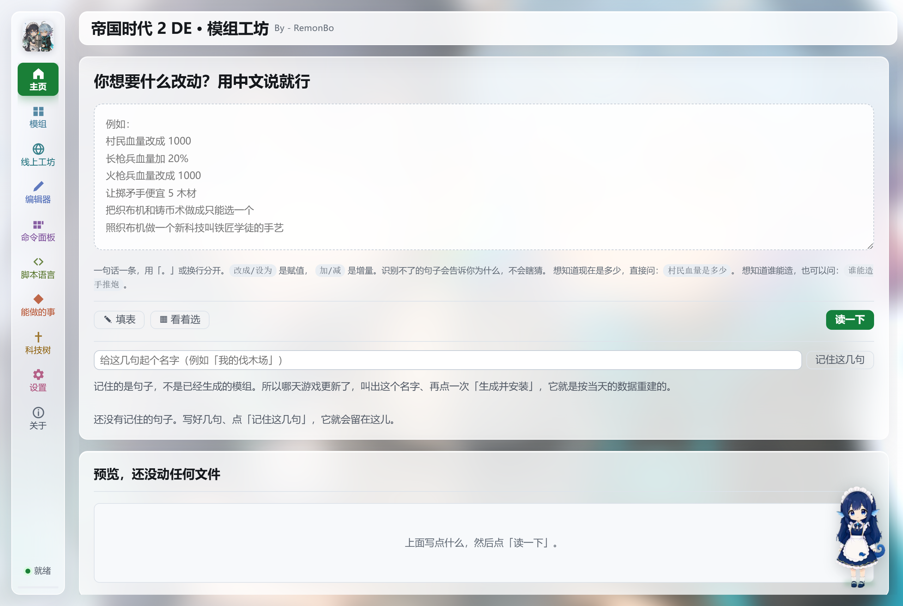
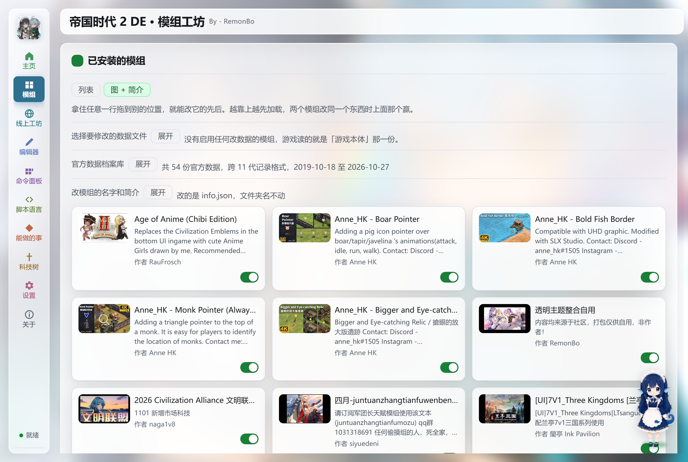
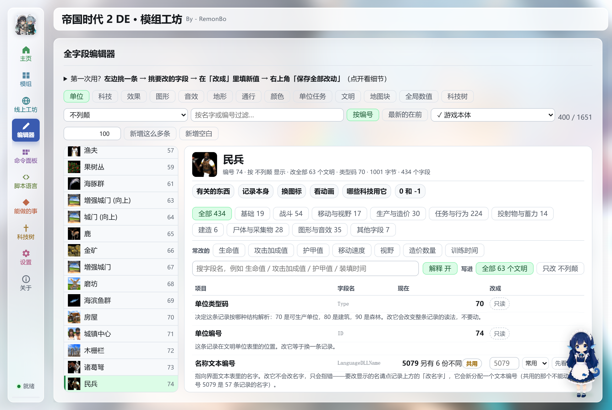
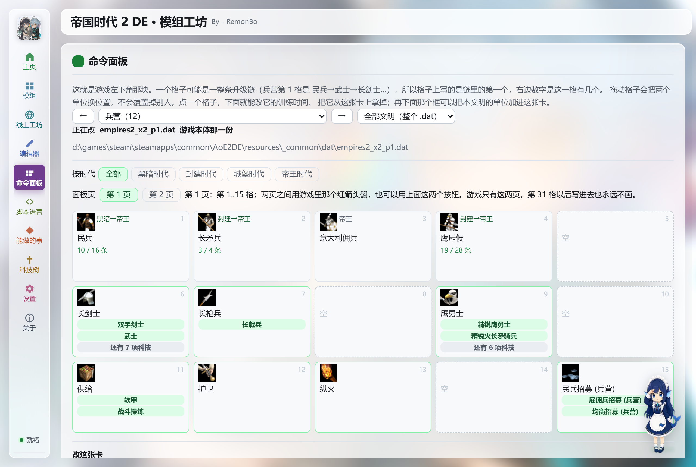
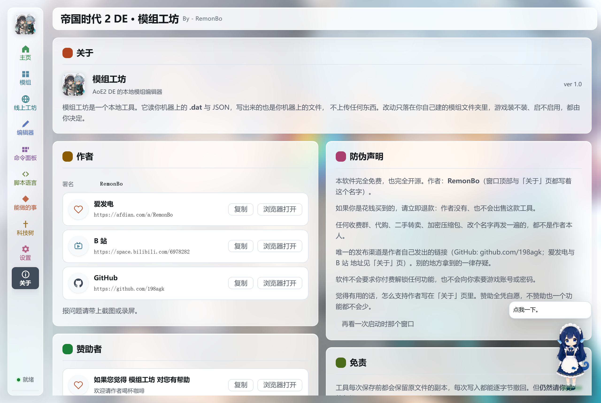

<p align="center">
  
</p>

<p align="center">
  <a href="https://github.com/198agk/AoE2ModWorkshop/releases/latest">
    
  </a>
  <a href="https://github.com/198agk/AoE2ModWorkshop">
    
  </a>
  <a href="https://github.com/198agk/AoE2ModWorkshop/releases">
    
  </a>
  
  
  
</p>

<p align="center">
  <b>用一句中文，改一份数据，生成一个能装进游戏的模组。</b><br>
  <sub>不写脚本、不开 AGE3、不碰游戏本体 —— 改的是你本机那份 .dat 的副本。</sub>
</p>

<p align="center">
  <a href="#核心亮点"></a>
</p>

## 使用须知

- **这是一个还在快速迭代的工具**，不是成熟产品。改数值、造单位、造科技、生成模组这几条已经实机走通；
  边缘形态（新科技不进科技树、禁科技的按钮是消失而不是变灰）写在[下面](#能做什么以及做不到什么)，
  都是**故意**留着的诚实边界，不是待修的 bug。
- **遇到问题欢迎开 issue**：<https://github.com/198agk/AoE2ModWorkshop/issues> 。
  报问题请带上截图或录屏，再说一句你在哪个页签 —— 说清在哪一页，才能照着走一遍。
- **它不会自己更新**。工具不联网后台拉包，也没有自动升级通道。要新版本就自己下新的安装包覆盖，
  或者打开「关于」页按「检查更新」看一眼 GitHub 上那份的版本号，再决定要不要换。
- **它不改你的游戏本体**。所有改动写在你本机 `.dat` 的副本上，装成一个普通本地模组；
  卸载 = 关掉模组 + 删一个文件夹，原版数据一个字节没动。
- **它完全免费、完全开源**。源代码全在这个仓库里，没有任何功能需要付费解锁。

## 核心亮点

改一个单位要开 AGE3 翻二十层结构，做一项新科技得同时动 `.dat`、文本、科技树三处，
改完还要自己拼一个能挂载的模组目录 —— 每一步都能失败，而且失败时游戏只是「没反应」。

**模组工坊把这条链压成一句话。**

| 亮点 | 说明 |
| --- | --- |
| **说人话就能改** | 「把不列颠村民的血量改成 1000」→ 预览改了哪几个字节 → 生成并安装。15 个意图覆盖改数值、造单位、造科技、换造型、改图标、做互斥组 |
| **每个字节都能点进去** | 十三个记录空间、约 116 万个数字，逐字段编辑，不写代码也能改到 `.dat` 的最深处 |
| **改完能验证** | 预览里看得见「哪张表第几条、原值 → 新值、动了几个字节」；生成前就拒绝掉这次构建救不回来的句子 |
| **闭环到游戏里** | 直接写出模组目录、装进玩家 profile、勾上开关；附带 54 份官方历史数据，游戏打补丁后能一键把旧模组适配到新版本 |
| **纯本地** | 不联网、不上传、不装驱动、不注入进程。游戏更新了随时重建，卸载就是删一个文件夹 |

## 界面预览

下面八张都是**发布包跑起来的界面**，不是开发服务器：窗口 1280×860，两倍像素密度。

| 首页 | 能做的事 |
| --- | --- |
| [](docs/screenshots/home.png) | [](docs/screenshots/intents.png) |
| **模组一览** | **逐字段编辑器** |
| [](docs/screenshots/mods.png) | [](docs/screenshots/editor.png) |
| **命令面板** | **科技树** |
| [](docs/screenshots/card.png) | [](docs/screenshots/tree.png) |
| **界面语言** | **关于** |
| [](docs/screenshots/lang.png) | [](docs/screenshots/about.png) |

## 它改的是什么

```
你的游戏数据 (empires2_x2_p1.dat)  ──读──┐
                                        ├─→  改出来的副本  ──写──→  模组目录  ──装──→  游戏
你的那句话        ──解析成 intent───────┘        （只动该动的字节）
```

- **不注入、不打补丁、不改游戏本体。** 它在你本机那份出厂 `.dat` 上另写一份，装成普通的**本地模组**，
  在「创建游戏」界面的「数据模组：」下拉框里选中就生效。
- **每一次改动都是可审的字节编辑。** 预览里写清「哪个表、第几条记录、哪个字段、原值、新值」；
  生成前先跑一遍验证，救不回来的句子当场拒绝，而不是装进游戏里让你自己发现没效果。
- **改完随时能回到干净状态。** 卸载 = 关掉模组 + 删那个文件夹，原版数据一个字节没动。

## 能做什么

### 一句话 → 一个模组

```
把不列颠村民的血量改成 1000
照织布机做一个新科技，叫铁匠学徒的手艺，研究时间 10，放在第 3 格
把锻造和步兵鳞甲做成只能研究其中一个
```

一句话里可以有好几件事（`村民血量改成 1000。弓箭手攻击力加 2`），会打进同一个模组。十五个意图：

| 说人话 | 意图 | 写哪里 |
|---|---|---|
| 改血量 / 攻击 / 护甲 / 移速 / 视野 … | `unit.stat` | `.dat` |
| 改某个单位对某类目标的攻击或护甲 | `unit.attack_class` | `.dat` |
| 改单位造价 | `unit.cost` | `.dat` |
| 改科技研究时间 / 造价 | `tech.research_time`、`tech.cost` | `.dat` |
| 改科技效果里的一条命令 | `tech.effect` | `.dat` |
| 让某个文明能 / 不能再造某单位 | `unit.availability` | 科技树 JSON + `.dat` |
| 让某个文明能 / 不能再研究某科技 | `tech.availability` | 科技树 JSON + `.dat` |
| 换掉单位的造型（借别人的动画） | `unit.sprite` | 松散 `.sld` |
| 给单位画一张新图 | `unit.art` | 松散 `.sld` |
| 照现成的单位做一个新单位，选格子 | `unit.create` | `.dat` + 文本 mod |
| 把几项科技做成只能研究其中一个 | `tech.toggle_group` | JSON + `.dat` |
| 做一项游戏里没有的科技 | `tech.create` | `.dat` + 文本 mod |
| 让某个单位在地图开局时换成另一个（含概率） | `unit.replace_on_map` | `objreplacement.json` + `.dat`（载体） |
| 把单位挪到命令卡的另一格 | `unit.card_move` | `.dat`（原地改一格） |

想让工具认得自己的说法，不用改 Python：放一个 `plugins/<名字>/schema/intents.json` 就多一个意图。

### 逐字段编辑器

句子覆盖的是最常见的十五件事；「编辑器」那一页覆盖 `.dat` 里**每一个**字节字段，十三个页签：

| 页签 | 记录数 | 一条记录几个字段 | 里面有什么 |
|---|---|---|---|
| 单位 | 挑选器里 1,651 个有名字的单位；文件里共 136,861 条（63 个文明各一份拷贝） | 190（村民那条 1,077） | 生命值、攻击、护甲、装填、视野、图形编号 |
| 科技 | 1,510 条 | 34 | 研究时间、`EffectID` 指针、限定文明、研究地点 |
| 图形 | 20,883 条 | 26 | `SlpID`、帧数、方向数、播放速度 |
| 音效 | 930 条 | 5 | 延迟、缓存时长、总概率 |
| 效果 | 1,500 条 / 55,500 个数字 | 2 + 每条命令 5 个槽 | 增减属性、乘算资源（织布机的 +15 生命值就在这） |
| 地形 | 200 条 | 19 | 名字、水域类型、图形、混合优先级、可通行位 |
| 通行 | 54 条 | 670 | 每种地形能不能走、走上去的建筑掉多少伤害 |
| 颜色 | 16 条 | 9 | 玩家 1..8 的队伍色、单位描边、选中环 |
| 单位任务 | 2,329 条 | 32 | 这个单位会干什么、对什么目标、干多远 |
| 文明 | 63 条 | 608 | 科技树、团队加成、界面皮肤、601 个资源系数 |
| 地图块 | 1 条 | 25 | 瓦片宽高、抬高一级、分块行列、可见与迷雾 |
| 全局数值 | 7 条 | 1 | 那 7 个计数器：时间切片、击杀率与总分… |
| 科技树 | 550 条 | 44 到 66 | 时代 / 建筑 / 单位 / 科技四种连线 |

这张表就是「能不能替代 AGE3」的答案。AGE3 有 620 个字段散在 43 个结构里；这里
**能点进去改的数字约 116 万个**（八张全局表 586,234 个可写槽 + 效果表 7,027 个 +
科技 37,834 个 + **一份文明**的单位 527,451 个；单位在 `.dat` 里按 63 个文明各存一份，
全部算上是 3,339 万个，但玩家改一份就能玩，所以报单份）。

**不只是改，还能多一条、少一条。** AGE3 的表格编辑器只能动现有的格子；这里能复制一条单位记录
（0.17 秒）、追加一条科技（0.045 秒）、再删回去，逐字节回到原始文件。

每一页为什么这样设计、量过什么、踩过哪些坑，全写在 **[docs/编辑器笔记.md](docs/编辑器笔记.md)**。

### 游戏打了补丁怎么办

工具每次打开都把当天那份官方 `.dat` 按格式代归档，包里已经带着 **54 份、108 个 build、跨 11 个格式代**
（最早到 2019 年 10 月发售前那次公测）。补丁把模组弄失效之后，「一键适配」会自己认出作者当初
照着改的是哪一份，把改动重新搬到新版本上 —— 而不是让你去翻 Steam 的旧版本。

它不是缓存，**删不得**：删了这个文件夹，一键适配只能如实拒绝，让你手动指定一份 `old.dat`。

## 安装

### 安装包（推荐）

从 [Releases](https://github.com/198agk/AoE2ModWorkshop/releases/latest) 下 `AoE2ModWorkshop-x.y.z-setup.exe`，
双击、下一步、装到 `%LOCALAPPDATA%\Programs\AoE2ModWorkshop`。不需要另装 Python（包里自带 3.12），
不需要管理员权限。卸载在「设置 → 应用」里，删得干净。

### 免安装

下 `AoE2ModWorkshop-x.y.z.zip`，解压到任意文件夹，双击 `aoe2-mod-workshop.exe`。

### 从源码跑

仓库里放的是源码，`.py` 和 `.html` 双击打不开。要跑源码：

```powershell
git clone https://github.com/198agk/AoE2ModWorkshop
cd AoE2ModWorkshop
python -X utf8 -u tools\run_ui.py     # 需要 Python 3.10+；默认随机端口，控制台会打印地址
```

> 本机若装过应用商店版 Python，PATH 上的 `python` 可能是存根（一试就弹商店），用绝对路径指到真正的解释器。

窗口里显示的就是本机服务发出来的页面：在框里打一句中文 → 「读一下」→ 看预览 → 「生成并安装」。

**开局前必须在「创建游戏」界面的「数据模组：」下拉框里选中它** —— 不是「模组」界面，那个界面没有这个下拉框。

## 能做什么，以及做不到什么

- **「变灰」做不到。** 禁掉一个科技的唯一机制是 `type 102`，它的表现是**按钮消失**，不是变灰。
- **新科技不进科技树面板**（它出现在研究卡上，不在树里）。
- **改不动游戏的渲染器。** `AoE2DE_s.exe` 是纯 native、没有 CLR 头，界面由游戏自己的渲染器解析。
  能换的是**磁盘上**的图片与布局文件，控件类集是封闭的，而且至今没有一局实测证明改 markup 会改变画面。
  所以这条写「改不动渲染器」，不写「改不了界面」。
- **同一个文件夹里 `.dat` 与 `widgetui` 只有一个生效**（2026-10-24：五次空框 vs 拆开四次画出）。
  这不是取舍，是要绕开的限制 —— 工具会自己拆成两个 mod，两个都要在模组界面里勾上。

实机验证过的每一条、以及每条「做不到」的原因，都写在 **[RELEASE.md](RELEASE.md)** 里，带日期。
诚实边界也写在每个生成的 manifest 的 `verification.not_proven` 里 —— 那几条是**故意**留着的。

## 项目结构

```
aoe2mod/            产品代码
  api.py            Toolkit：plan / build / install / mods / browse / icon_for …
  intent/           compiler（把 intent 翻成字节编辑）、reskin、retarget、datgrant
  dat/              .dat 读写（parser / writer / locate 是 vendored，见下）
  game/             icons、linkedtechs、civtechtrees、locations、ddstex
  mod/              emitter（写 mod 目录）、strings、archives（官方数据档案库）、upgrade
  repair.py         读回一个社区模组：改了什么、还能不能救
  ai.py             AI 接入口：只把愿望换成句子，绝不产出 intent
  semantic/         名字索引、prose
  schema/           intents.json（15 个意图）、dat_bindings.json、中文标签表
  ui/               server.py（本地 HTTP）、nl.py（中文句子 → intent）、static/
plugins/            <名字>/schema/intents.json 就多一个意图，不用写 Python
tools/              run_ui.py（唯一入口）、sync_engine.py
docs/               编辑器笔记、截图
_probe/             验证层：quick 套件 234 条 + 长套件 17 条，以及它们要用到的几个 vendored 源
```

两条环境铁律：

1. `aoe2mod/dat/{parser,writer,locate}.py` 是 **vendored** —— 直接改无效，下次 `tools/sync_engine.py`
   会覆盖。要改就改 `_probe/datparse/` 与 `_probe/serializer/` 里的源。
2. 超过几句话的 Python 不要内联在 shell 里（here-string 会吞引号），写成 `.py` 再跑。

## 开发与验证

逆向一个闭源引擎没有文档可查。「建造菜单的按钮格由哪个字段决定」「新字符串 id 能不能渲染」
这类问题只能改一个字节、请人开一局、看屏幕上有没有变。所以 `_probe/` 里全是钉子：
每条钉子对应一次被证实的结论，或一次被推翻的假设。

```powershell
python -X utf8 -u _probe\run_suites.py    # 234 条快套件，约 100 分钟
python -X utf8 -u _probe\run_long.py      # 17 条长套件，约 2.8 小时
```

改动要落到发布包再验：源码 → 包内 app 目录 → 起包里那个 exe 逐条打路由。只跑 dev 服务不算验过。

### 这份代码是怎么写出来的

**全部由 AI 写，模型是 Deepseek-V4.1-Flash**（DeepSeek 的对话模型），人类负责定方向、
在真游戏里开一局验证结论、以及拒绝那些「看起来能跑但没实测」的改动。

这不是要标榜什么，而是为了说清两件事：

- **为什么 `_probe/` 这么大。** 一个不查文档的模型最容易犯的错是「编一个看起来合理的字段含义」，
  而且错了不会崩、只会「装了模组没反应」。所以每条结论都被写成一条能重跑的钉子，
  随时可以回头把「我之前以为」证伪。
- **为什么代码风格这么「笨」。** 少用魔法、少抽象、字段名写得长、注释里写清「为什么不是另一种写法」，
  是因为下一个读它的人（或模型）没有本次会话的上下文。

## 想用 AI 帮你说那句话

设三个环境变量再启动，页面会多一个「问问 AI」按钮（任何 OpenAI 兼容端点）：

```powershell
$env:AOE2MOD_AI_BASE  = 'https://api.openai.com/v1'
$env:AOE2MOD_AI_KEY   = 'sk-...'
$env:AOE2MOD_AI_MODEL = 'gpt-4o-mini'
```

**它只会把你说的话换成这个工具认得的句子**，不产生任何改动。句子仍然要过「读一下」那一关、
仍然要看预览能不能构建。配置只从环境变量读，项目不存任何 key。

## 请我们喝咖啡

<p align="center">
  如果这个工具帮你省下了几个小时翻 AGE3 的时间，<br>
  或者让你第一次把「把不列颠村民血量改成 1000」这种想法真的做进了游戏里 ——
</p>

<p align="center">
  <a href="https://afdian.com/a/RemonBo">
    
  </a>
</p>

完全免费、完全开源，功能不会因为不赞助而少一个。爱发电上来的钱只做一件事：
让作者有理由继续在周末开一局游戏、改一个字节、把它记成一条钉子。

## 许可

**可以**：私人使用、修改、分享、拿去改自己的模组、在视频和帖子里展示、放进你自己的整合包（只要你也不收钱）。
**不可以**：任何商业用途 —— 收费下载、付费网盘、会员专享、塞进付费整合包、「进群领工具」换钱、企业内部生产使用。

许可正文是 **PolyForm Noncommercial License 1.0.0**，全文在 [LICENSE](LICENSE)。

**署名**：二次发布（含改版、换皮、整合包）必须在仓库 README 与产品「关于」页写明原作者与
<https://github.com/198agk>，不得删改署名后再发。这一条是 LICENSE 之外作者另行要求的条件；
不接受的，LICENSE 授予的使用权不适用于你。

**游戏素材不在许可范围内**：本工具不包含、不分发游戏素材。它读写的是你本机安装的游戏数据，
那些数据的版权属于游戏发行方。包里带的第三方组件（CPython、bottle、pythonnet、Tauri 等）
各自的许可与版本逐条列在 [NOTICE](NOTICE)。

**关于反逆向**：发布包做了完整性校验（逐文件哈希 + 签名）、引擎以加密包形式加载、每个包带买家水印。
这不是为了防你 —— 你完全可以读仓库里的源码、自己编译、自己改。它只防一种事：**改过的东西冒充原版发出去**。
做法与边界写在 [ANTI-REVERSE.md](ANTI-REVERSE.md)。

## 致谢

- [genieutils](https://github.com/SiegeEngineers/genieutils) 与 [AGE](https://github.com/SiegeEngineers/AGE)
  是这份解析器最初的参照：`.dat` 的字段名、顺序与语义大多能在它们那里找到出处。
- 图标、引导与实测来自社区玩家：每一条「实机看见了」都是有人真的开了一局。
