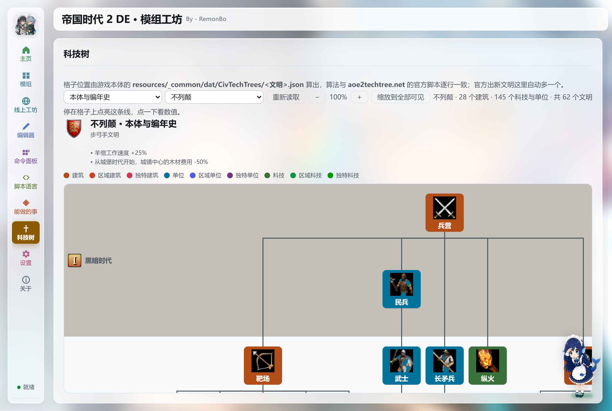
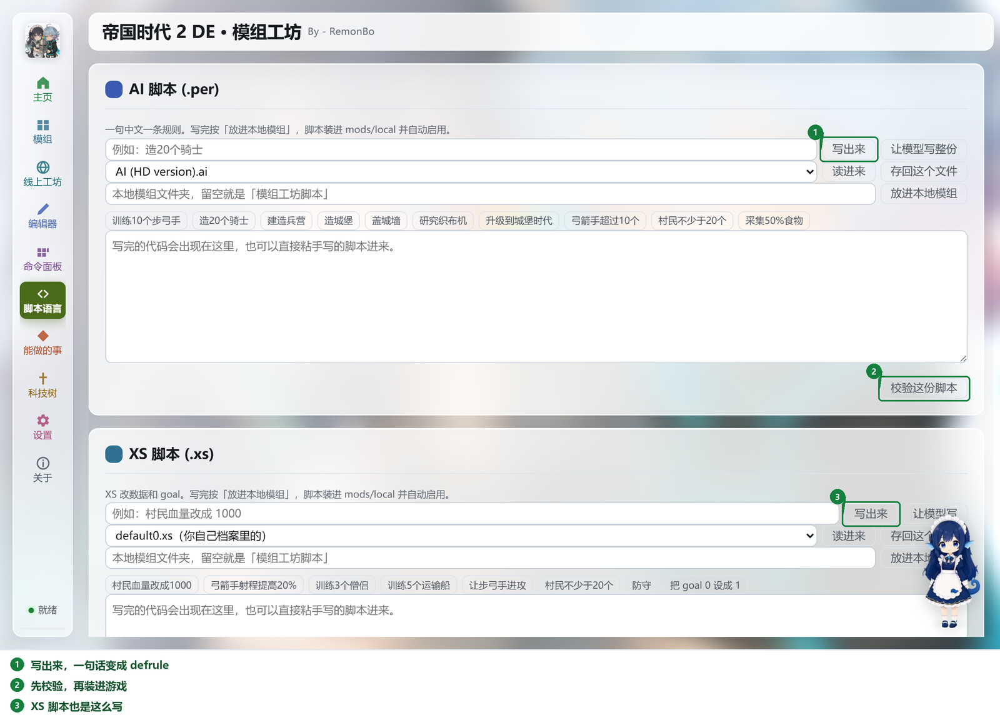

<p align="center">
  
</p>

<p align="center">
  <a href="https://github.com/198agk/AoE2ModWorkshop/releases/latest"></a>
  
  
  
</p>

<p align="center">
  <b>用一句中文，改一份数据，生成一个能装进游戏的模组。</b>
</p>

<p align="center">
  <a href="#界面预览"></a>
</p>

## 功能

| | |
| --- | --- |
| **一句话改模组** | 「把不列颠村民的血量改成 1000」→ 预览 → 生成并安装。15 个意图，一句话里可以有好几件事 |
| **逐字段编辑器** | 13 个页签、约 116 万个数字，`.dat` 里每一个字段都能点进去改 |
| **多条少条** | 复制一条单位记录、追加一项科技，也能删回去 |
| **改完能验证** | 预览写清哪张表第几条、原值 → 新值、动了几个字节；救不回来的句子当场拒绝 |
| **一键装进游戏** | 写出模组目录、装进玩家 profile、勾上开关 |
| **补丁后一键适配** | 自带 54 份官方历史数据，游戏更新后把旧模组搬到新版本 |
| **读回别人的模组** | 打开一个社区模组，看它改了什么、还能不能救 |
| **AI 说人话** | 接任意 OpenAI 兼容端点，把愿望换成这个工具认得的句子 |

## 界面预览

| | |
| --- | --- |
| **首页** | **能做的事** |
| [](docs/screenshots/home.png) | [](docs/screenshots/intents.png) |
| **模组一览** | **逐字段编辑器** |
| [](docs/screenshots/mods.png) | [](docs/screenshots/editor.png) |
| **命令面板** | **科技树** |
| [](docs/screenshots/card.png) | [](docs/screenshots/tree.png) |
| **界面语言** | **关于** |
| [](docs/screenshots/lang.png) | [](docs/screenshots/about.png) |

## 能做什么（15 个意图）

```
把不列颠村民的血量改成 1000
照织布机做一个新科技，叫铁匠学徒的手艺，研究时间 10，放在第 3 格
把锻造和步兵鳞甲做成只能研究其中一个
```

| 说人话 | 意图 | 写哪里 |
|---|---|---|
| 改血量 / 攻击 / 护甲 / 移速 / 视野 | `unit.stat` | `.dat` |
| 改某单位对某类目标的攻击或护甲 | `unit.attack_class` | `.dat` |
| 改单位造价 | `unit.cost` | `.dat` |
| 改科技研究时间 / 造价 | `tech.research_time`、`tech.cost` | `.dat` |
| 改科技效果里的一条命令 | `tech.effect` | `.dat` |
| 让某文明能 / 不能再造某单位 | `unit.availability` | 科技树 JSON + `.dat` |
| 让某文明能 / 不能再研究某科技 | `tech.availability` | 科技树 JSON + `.dat` |
| 换掉单位的造型 | `unit.sprite` | 松散 `.sld` |
| 给单位画一张新图 | `unit.art` | 松散 `.sld` |
| 照现成单位做一个新单位 | `unit.create` | `.dat` + 文本 mod |
| 几项科技只能研究其中一个 | `tech.toggle_group` | JSON + `.dat` |
| 做一项游戏里没有的科技 | `tech.create` | `.dat` + 文本 mod |
| 开局时把某单位换成另一个 | `unit.replace_on_map` | `objreplacement.json` + `.dat` |
| 把单位挪到命令卡另一格 | `unit.card_move` | `.dat` |

放一个 `plugins/<名字>/schema/intents.json` 就多一个意图，不用改 Python。

## 编辑器页签

| 页签 | 记录数 | 字段 |
|---|---|---|
| 单位 | 挑选器 1,651 个；文件里 136,861 条（63 文明各一份） | 190 |
| 科技 | 1,510 条 | 34 |
| 图形 | 20,883 条 | 26 |
| 音效 | 930 条 | 5 |
| 效果 | 1,500 条 / 55,500 个数字 | 2 + 命令 5 槽 |
| 地形 | 200 条 | 19 |
| 通行 | 54 条 | 670 |
| 颜色 | 16 条 | 9 |
| 单位任务 | 2,329 条 | 32 |
| 文明 | 63 条 | 608 |
| 地图块 | 1 条 | 25 |
| 全局数值 | 7 条 | 1 |
| 科技树 | 550 条 | 44 到 66 |

## 三十秒上手

**双击根目录里的 `启动模组工坊.cmd`。** 就这一步。

它会自己找 python —— 先找已知的那份 `dependencies\python\python.exe`，再找 `py` 启动器，
最后才用 PATH 上的 `python`（那个可能是应用商店的存根，一试就弹商店）—— 然后在**一个窗口里**
打开工坊。出错时窗口会停住并留下原因，不会一闪就没。

> 窗口：页面在一个原生窗口里开，没有地址栏、不会误点走。用的是本机的 Edge WebView2 运行时，
> 不打包、不构建。万一某个环境装不了 `pywebview`，它会自己退回浏览器并说明原因 ——
> 「要窗口」和「能开」是两件事。想强制只要窗口（开不了就报错而不是退回）加 `--window`，
> 想回到浏览器老行为加 `--browser`。

图标那层也能写：`unit.create` / `tech.create` 都带得动一张自己的图，**已经在一局真游戏里画出来过** —— 产品自己发出去的图标，出现在城镇中心的命令卡上，用的是自动分配的新槽。
`.dat` 与 `widgetui` 要拆成两个 mod 才画得出来，放同一个文件夹里是空框。

## 安装

**安装包**：从 [Releases](https://github.com/198agk/AoE2ModWorkshop/releases/latest) 下
`AoE2ModWorkshop-1.0.0-setup.exe`（273 MB），双击下一步，装到 `%LOCALAPPDATA%\Programs\AoE2ModWorkshop`。
自带 Python 3.12，不需要管理员权限，卸载在「设置 → 应用」里。

**免安装**：下 `AoE2ModWorkshop.zip`（351 MB），解压，双击 `aoe2-mod-workshop.exe`。

**从源码跑**：

```powershell
git clone https://github.com/198agk/AoE2ModWorkshop
cd AoE2ModWorkshop
python -X utf8 -u tools\run_ui.py     # 需要 Python 3.10+，控制台会打印地址
```

开局前在「创建游戏」界面的「数据模组：」下拉框里选中它 —— 不是「模组」界面。

## 做不到什么

- **「变灰」做不到**，禁科技的表现是按钮消失。
- **新科技不进科技树面板**，它出现在研究卡上。
- **改不动渲染器**，能换的是磁盘上的图片与布局文件。
- **同一文件夹里 `.dat` 与 `widgetui` 只有一个生效**，工具会拆成两个 mod，两个都要勾上。

每条的实测记录在 [RELEASE.md](RELEASE.md)。

## 使用须知

- 还在快速迭代，数值、造单位、造科技、生成模组已经实机走通。
- 有问题开 [issue](https://github.com/198agk/AoE2ModWorkshop/issues)，带截图或录屏，说清在哪个页签。
- **它不会自己更新**，要新版就下新安装包覆盖，或「关于」页按「检查更新」。
- 不改游戏本体，改动写在本机 `.dat` 的副本上，卸载 = 删一个文件夹。
- 完全免费、完全开源。

## 开发

需要 Python 3.10+。装好的包自带 `runtime\python.exe`；从源码跑用系统那份，命令一样。

```powershell
python -X utf8 -u '_probe\run_suites.py'    # 234 条快套件，约 100 分钟
python -X utf8 -u '_probe\run_long.py'      # 17 条长套件，约 2.8 小时
```

两条环境铁律：

1. `aoe2mod/dat/{parser,writer,locate}.py` 是 **vendored** —— 直接改无效，下次 `tools\sync_engine.py`
   会覆盖。要改就改 `_probe/datparse/` 与 `_probe/serializer/` 里的源，再跑一次同步。
2. 超过几句话的 Python 不要内联在 shell 里（here-string 会吞引号），写成 `.py` 再跑。

接大模型只从环境变量读，三条都认：

```powershell
$env:AOE2MOD_AI_BASE  = 'https://api.openai.com/v1'
$env:AOE2MOD_AI_KEY   = 'sk-...'
$env:AOE2MOD_AI_MODEL = 'gpt-4o-mini'
```

**它只会把你说的话换成这个工具认得的句子**，不产生任何改动：句子仍然要过「读一下」那一关、
仍然要看预览能不能构建。配置只从环境变量读，项目不存任何 key。

全部由 AI 写，模型是 **Deepseek-V4.1-Flash**；人负责定方向、在真游戏里开一局验证、拒掉没实测的改动。

## ☕ 请我们喝咖啡

如果 模组工坊 帮你省下了不少时间，不妨请开发者喝杯咖啡？

你的支持是我持续更新的最大动力！💖

<a href="https://afdian.com/a/RemonBo"></a>

## 许可

**可以**：私人使用、修改、分享、改自己的模组、视频展示、放进免费整合包。
**不可以**：任何商业用途 —— 收费下载、付费网盘、会员专享、付费整合包、企业生产使用。

正文是 **PolyForm Noncommercial License 1.0.0**，全文在 [LICENSE](LICENSE)。
二次发布须在 README 与产品「关于」页写明原作者与 <https://github.com/198agk>。

游戏素材不在许可范围内：本工具不包含、不分发游戏素材。

## 致谢

[genieutils](https://github.com/SiegeEngineers/genie-rs) 与社区版 Advanced Genie Editor。