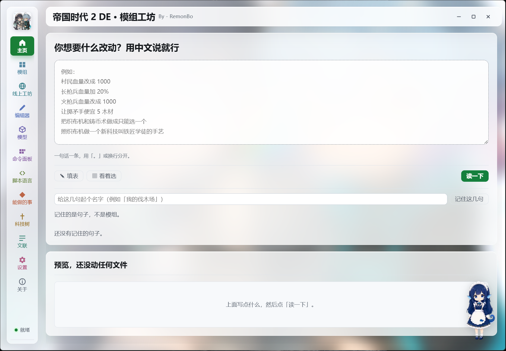
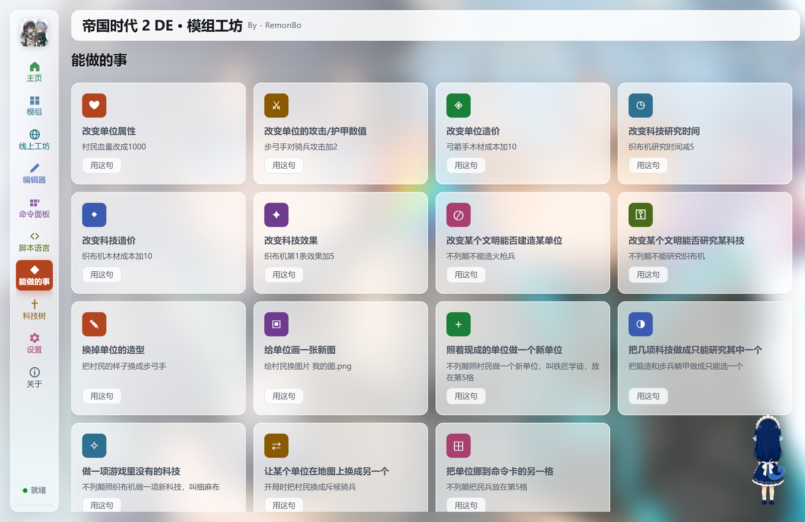
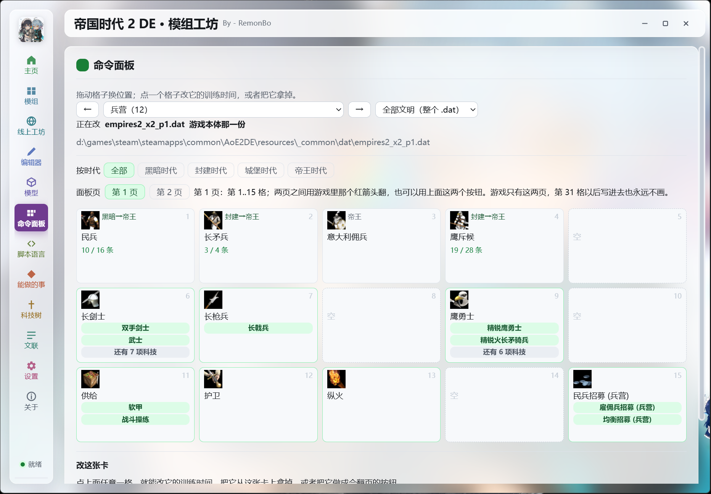
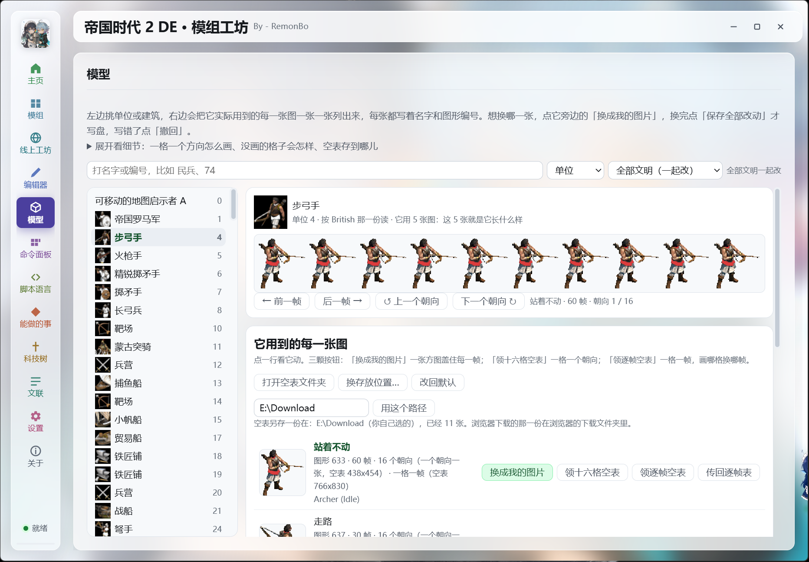
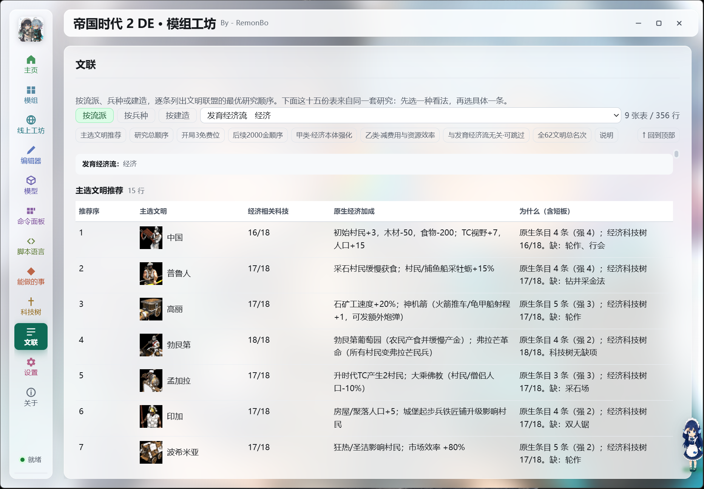
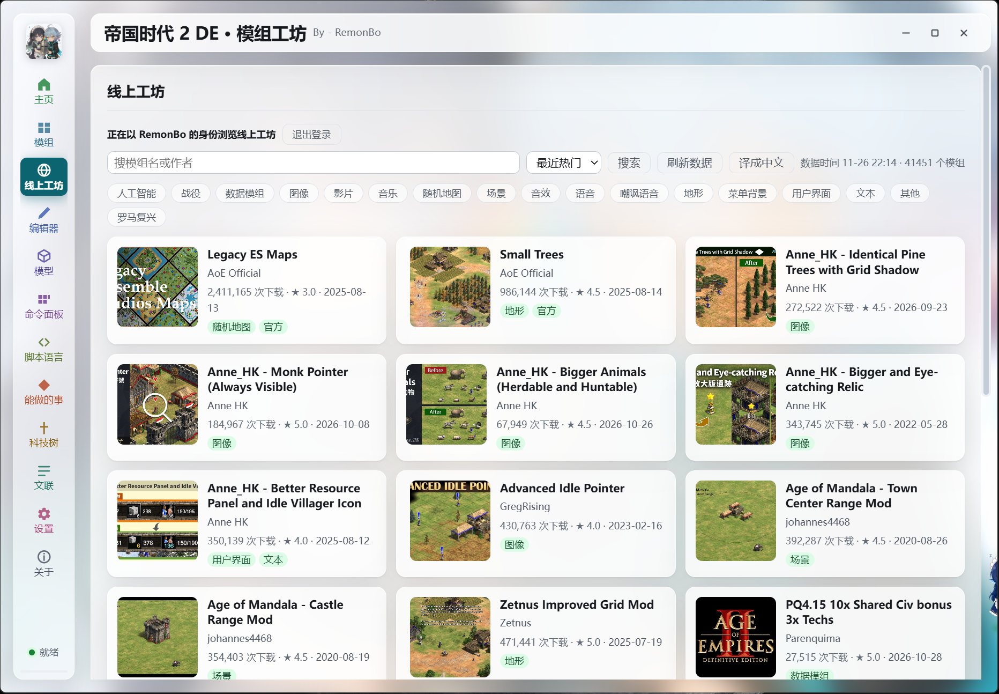
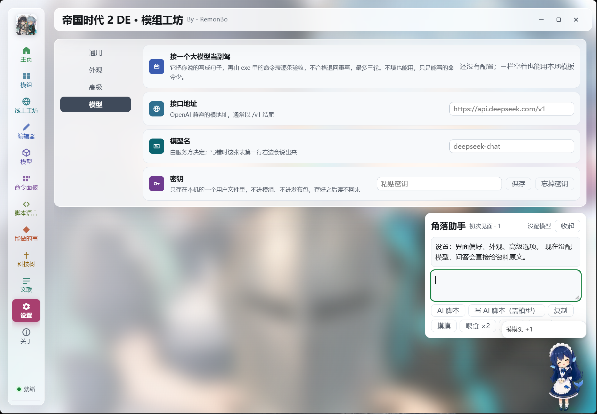
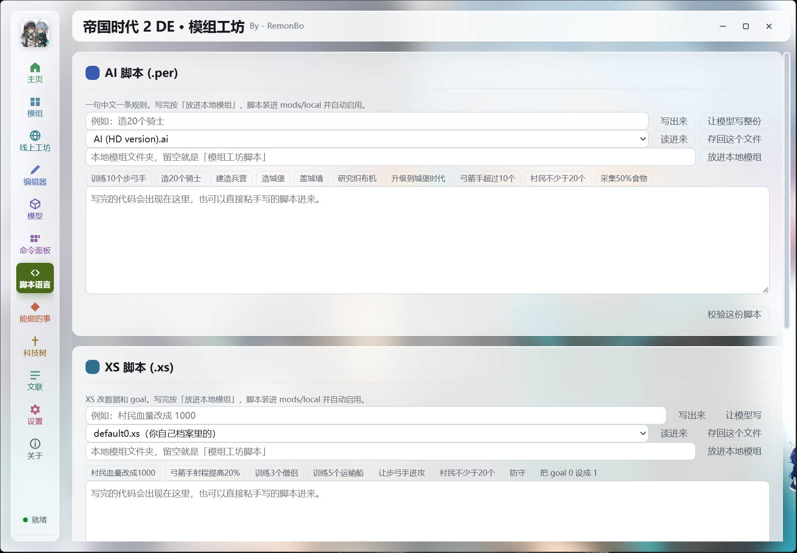

<p align="center">
  
</p>

<p align="center">
  <a href="https://github.com/198agk/AoE2DEModWorkshop/releases/latest"></a>
  
  
  
</p>

<p align="center">
  <b>用一句中文，改一份数据，生成一个能装进游戏的模组。</b>
</p>

<p align="center">
  <a href="#界面预览"></a>
</p>

<p align="center">
  <a href="docs/教程.md"><b>📖 图文教程</b></a> ·
  <a href="docs/教程.html">网页版</a> ·
  <a href="https://www.bilibili.com/opus/1275265241515556867">B 站专栏</a>
</p>

一款用于修改《帝国时代2决定版》数据的工具。本软件借 AI 协助开发，模型是 **Deepseek-V4.1-Flash**。

目前大多数功能都处于测试阶段 —— 因为没啥人用，需要更多测试数据和反馈报告，才能持续优化完善。欢迎试用，遇到问题请带截图或录屏开 [issue](https://github.com/198agk/AoE2DEModWorkshop/issues)。

## 安装

从 [Releases](https://github.com/198agk/AoE2DEModWorkshop/releases/latest) 下安装包，双击，下一步。
装到 `%LOCALAPPDATA%\Programs\AoE2ModWorkshop`，自带 Python 3.12，不需要管理员权限，
卸载在「设置 → 应用」里。不想装就下免安装包，解压后双击目录里的 `AoE2 DE Mod Workshop.exe`。

| 文件 | 怎么用 |
| --- | --- |
| `AoE2DEModWorkshop-1.7.0-setup.exe`（273 MB） | 双击安装 |
| `AoE2DEModWorkshop.zip`（351 MB） | 解压，双击 `AoE2 DE Mod Workshop.exe` |

装好之后还要在游戏里自己选一次，否则改动不生效：进「**单人游戏 → 创建游戏**」，在设置画面里找到「数据模组：」那一项，从下拉框里挑本软件生成的那个。**它不是「模组」界面里的开关**，别在那里找，翻穿了也没有。

这个仓库装的是**源码**，不是给人拿去跑的东西：要用工坊请用上面两个文件。

## 功能

| | |
| --- | --- |
| **一句话改模组** | 「把不列颠村民的血量改成 1000」→ 预览 → 生成并安装。15 个意图，一句话里可以有好几件事 |
| **逐字段编辑器** | 13 个页签、约 116 万个数字，`.dat` 里每一个字段都能点进去改 |
| **换模型** | 一个单位的每一张图摊成一列：缩略图 + 名字 + 图形编号，点一行当场看它动，点「换成我的图片」挑自己的图（整张方图会被缩成马赛克，所以另有「领十六格空表」：服务器按这个文件自己的像素格算出空表尺寸，一格画一个方向再整张传回来，一格就是游戏里的一帧、按原尺寸贴；空表是一张白底的图，不是透明图层（整张每个像素都是实的，打开就是一张正常的图），格子里那层淡灰是游戏原画的剪影，照着影子描就行，画上去的地方就盖掉它，没画到的地方留游戏原画；领下来的空表除了浏览器下载的那份，工具还会另存一份在 `<工具目录>\sheets\`，页面上「打开空表文件夹」直接到那儿，「换存放位置…」能改到你自己的图片文件夹并记住（重开还在，「改回默认」退回原处）；还有「领逐帧空表」：一个朝向里每一帧各占一格，画哪格换哪帧，没画的格子原样留游戏的原像素（走路那种帧帧不一样的动作用这条，才不是十六张一模一样的图；只画一小块也不会把那一帧其余部分抹掉——没画到的像素拿游戏原样补回来，那一帧的团队色也照旧染在披风上）；单张那条路是一张就够，它盖住这张图的每一个朝向，整张文件同一尺寸、脚踩地面，连高清那份一起重画；预览画的是游戏里真正显示的那份高清图，条带旁边两颗按钮换十六个朝向，出厂文件里只记「这一帧变了哪几格」的那些帧也连起来放（取景框挪动时按画布上的位置接，不留残影），所以看到的就是游戏里那一格）；列表能一次全拉到一千多条；还没起名字的编号直接打数字也能打开 |
| **多条少条** | 复制一条单位记录、追加一项科技，也能删回去 |
| **改完能验证** | 预览写清哪张表第几条、原值 → 新值、动了几个字节；救不回来的句子当场拒绝 |
| **一键装进游戏** | 写出模组目录、装进玩家 profile、勾上开关 |
| **自检更新模组** | 游戏一更新，一键查你装的旧模组还能不能搬到今天的数据上，能搬的当场搬。内置 **54 份官方数据**，跨 11 代记录格式（2019-10-18 至 2026-10-27） |
| **读回别人的模组** | 打开一个社区模组，看它改了什么、还能不能救 |
| **线上创意工坊** | 不开游戏也能搜模组，但要登录（Steam 或微软账号，走游戏自己的接口），因为官方工坊不登录不给看。账号只存本机内存、不存 cookie，每次关掉都得重新登录 |
| **AI 说人话** | 接任意 OpenAI 兼容端点，把愿望换成这个工具认得的句子；右下角那个大肥鱼（角落助手）就是它 |
| **文联** | 录了十五个流派的研究顺序表：经济、步兵、弓兵、散兵、骑兵、骆驼弓、战象、喷火兵、城堡、塔、炮塔、弩炮、投石机、海战、火焰骆驼。三种看法进的是同一批表：「按流派」一本一本翻，「按兵种」「按建造」只是换个名字找到自己那个流派。每本里逐格列着开局三个免费位怎么用、后面两千金按什么顺序花、哪几项是这个流派的本体强化、哪几项只是减费用和资源效率、哪几项跟这个流派无关可以直接跳过，最后是全 62 文明的总名次和一句说明；写着「文明」的那一列会把该文明的独特单位头像画在旁边，一眼看得到自己玩的是谁 |

## 图文教程


从「挑 dat」到「装进游戏」，一步一图，25 张全在 [docs/教程.md](docs/教程.md)（也有 [网页版](docs/教程.html)）。上面这个动图是模组列表拖动排序，另一个动图 [多窗口复制粘贴](docs/screenshots/tutorial/17-multiwindow.gif) 在第四节。

## 界面预览

| | |
| --- | --- |
| **首页** | **能做的事** |
| [](docs/screenshots/tutorial/02-home.png) | [](docs/screenshots/intents.png) |
| **模组页** | **逐字段编辑器** |
| [](docs/screenshots/tutorial/03-mods.png) | [](docs/screenshots/tutorial/13-editor.png) |
| **命令面板** | **科技树** |
| [](docs/screenshots/tutorial/19-cards1.png) | [](docs/screenshots/tutorial/22-techtree.png) |
| **模型** | **文联** |
| [](docs/screenshots/tutorial/18-model.png) | [](docs/screenshots/tutorial/23-lian.png) |
| **线上工坊** | **AI 模型接口** |
| [](docs/screenshots/tutorial/12-online-in.png) | [](docs/screenshots/tutorial/24-ai.png) |
| **读一下之后的预览** | **关于** |
| [](docs/screenshots/parse.png) | [](docs/screenshots/tutorial/25-about.png) |
| **设置** | **AI 脚本 / XS 脚本** |
| [](docs/screenshots/settings.png) | [](docs/screenshots/tutorial/21-script.png) |

## 能做什么（15 个意图）

```
把不列颠村民的血量改成 1000
照织布机做一个新科技，叫铁匠学徒的手艺，研究时间 10，放在第 3 格
把锻造和步兵鳞甲做成只能研究其中一个
```

| 说人话 | 意图 | 写哪里 |
|---|---|---|
| 改血量 / 攻击 / 护甲 / 移速 / 视野 | `unit.stat` | `.dat` |
| 改某单位对某类目标的攻击或护甲 | `unit.attack_class` | `.dat` |
| 改单位造价 | `unit.cost` | `.dat` |
| 改科技研究时间 / 造价 | `tech.research_time`、`tech.cost` | `.dat` |
| 改科技效果里的一条命令 | `tech.effect` | `.dat` |
| 让某文明能 / 不能再造某单位 | `unit.availability` | 科技树 JSON + `.dat` |
| 让某文明能 / 不能再研究某科技 | `tech.availability` | 科技树 JSON + `.dat` |
| 换掉单位的造型 | `unit.sprite` | 松散 `.sld` |
| 给单位画一张新图 | `unit.art` | 松散 `.sld` |
| 照现成单位做一个新单位 | `unit.create` | `.dat` + 文本 mod |
| 几项科技只能研究其中一个 | `tech.toggle_group` | JSON + `.dat` |
| 做一项游戏里没有的科技 | `tech.create` | `.dat` + 文本 mod |
| 开局时把某单位换成另一个 | `unit.replace_on_map` | `objreplacement.json` + `.dat` |
| 把单位挪到命令卡另一格 | `unit.card_move` | `.dat` |

## 编辑器页签

| 页签 | 记录数 | 字段 |
|---|---|---|
| 单位 | 挑选器 1,651 个；文件里 136,861 条（63 文明各一份） | 190 |
| 科技 | 1,510 条 | 34 |
| 图形 | 20,883 条 | 26 |
| 音效 | 930 条 | 5 |
| 效果 | 1,500 条 / 55,500 个数字 | 2 + 命令 5 槽 |
| 地形 | 200 条 | 19 |
| 通行 | 54 条 | 670 |
| 颜色 | 16 条 | 9 |
| 单位任务 | 2,329 条 | 32 |
| 文明 | 63 条 | 608 |
| 地图块 | 1 条 | 25 |
| 全局数值 | 7 条 | 1 |
| 科技树 | 550 条 | 44 到 66 |

这张表跟 AGE3 一样按 id 走：数据内容的编辑全是通过改 id 来的，具体 id 解析找资料。

## 做不到什么

- **「变灰」做不到**，禁科技的表现是按钮消失。
- **新科技不进科技树面板**，它出现在研究卡上。
- **改不动渲染器**，能换的是磁盘上的图片与布局文件。
- **同一文件夹里 `.dat` 与 `widgetui` 只有一个生效**，工具会拆成两个 mod，两个都要勾上。

每条的实测记录在 [RELEASE.md](RELEASE.md)。

## 使用须知

- 还在快速迭代、测试阶段，数值、造单位、造科技、生成模组已经实机走通，其余功能会陆续补。
- 有问题开 [issue](https://github.com/198agk/AoE2DEModWorkshop/issues)，带截图或录屏，说清在哪个页签、哪一步。
- **能自己更新**：「关于」页按下「检查更新」，有新版会出现「下载并装好」，工具自己下载、校验、换掉旧文件并重新打开。只在安装版里能用。
- **读写都在本机，不联网、不上传、不盗号。** 改动写在本机 `.dat` 的副本上，卸载 = 删一个文件夹。
- 大模型接口的密钥只存在本机的一个用户文件里，不上传、不进仓库、不写进模组。
- 完全免费、完全开源。

## 开发

本软件借 AI 开发：方向和验收由人来做，模型是 **Deepseek-V4.1-Flash**。

需要 Python 3.10+。改完这样验：

```powershell
python -X utf8 -u '_probe\run_suites.py'    # 251 条快套件，约 100 分钟
python -X utf8 -u '_probe\run_long.py'      # 17 条长套件，约 2.8 小时
```

发版：版本号写成三段 `大.中.小`（`1.7.0`、`1.8.0`），只有小号是 0 的才发，平时改代码只动小号不发布。
`python -X utf8 _probe\publish_release.py` 会拒绝其它号码，发布后只留最近三个发行，
剪掉的说明按顺序记在 [docs/CHANGELOG.md](docs/CHANGELOG.md)。

两条环境铁律：

1. `aoe2mod/dat/{parser,writer,locate}.py` 是 **vendored** —— 直接改无效，下次 `tools\sync_engine.py`
   会覆盖。要改就改 `_probe/datparse/` 与 `_probe/serializer/` 里的源，再跑一次同步。
2. 超过几句话的 Python 不要内联在 shell 里（here-string 会吞引号），写成 `.py` 再跑。

AI 那条口的地址、模型名和密钥在「设置」里填，也认三个环境变量：

```powershell
$env:AOE2MOD_AI_BASE  = 'https://api.openai.com/v1'
$env:AOE2MOD_AI_KEY   = 'sk-...'
$env:AOE2MOD_AI_MODEL = 'gpt-4o-mini'
```

**它只会把你说的话换成这个工具认得的句子**，不产生任何改动：句子仍然要过「读一下」那一关、
仍然要看预览能不能构建。配置只从环境变量读，项目不存任何 key。

## ☕ 请我们喝咖啡

如果 模组工坊 帮你省下了不少时间，不妨请开发者喝杯咖啡？

你的支持是我持续更新的最大动力！💖

<a href="https://afdian.com/a/RemonBo"></a>

## 许可与声明

**可以**：私人使用、修改、分享、改自己的模组、视频展示、放进免费整合包。
**不可以**：任何商业用途 —— 收费下载、付费网盘、会员专享、付费整合包、收费群、代购、二手转卖、加密压缩包、企业生产使用，以及任何盗版修改行为和未经授权的行为。

正文是 **PolyForm Noncommercial License 1.0.0**，全文在 [LICENSE](LICENSE)。
二次发布须在 README 与产品「关于」页写明原作者与 <https://github.com/198agk>。

游戏素材不在许可范围内：本工具不包含、不分发游戏素材。

**如果你是花钱买到的，请立即退款**：作者没有、也不会出售这款工具。

## 致谢

[genieutils](https://github.com/SiegeEngineers/genie-utils) 与社区版 Advanced Genie Editor。
