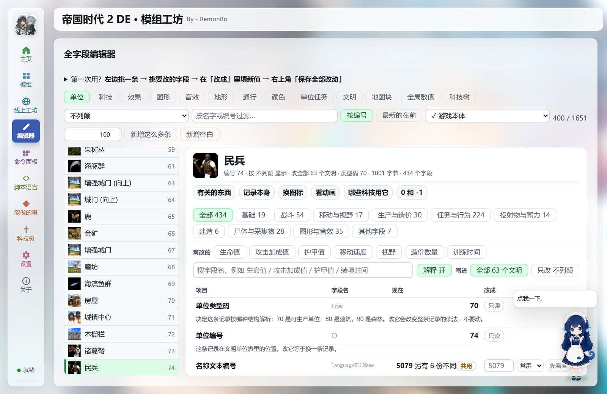

# 模组工坊 · 图文介绍与上手教程

> 用一句中文，改一份数据，生成一个能装进游戏的模组。
> 本文对着真实界面截图走一遍：从解压到进游戏看到效果，大约二十分钟。


---

## 一、这是什么

《帝国时代 2 决定版》的数值全靠一个二进制文件撑着：`resources/_common/dat/empires2_x2_p1.dat`。
单位多少血、走多快、一箭射多远、造一个要几块木头，全在这一个文件里，几万个数字挨在一起，改错一个字节游戏就打不开。

模组工坊把这个文件变成能看懂的东西：**你写中文，它告诉你这句话对应哪个单位的哪个字段、原来多少、改成多少、动了几个字节，然后再替你写成模组。**

它不碰游戏本体。所有改动都写在这份 .dat 的副本上，装成模组放进游戏的 mods 目录，卸载就是删一个文件夹。

| 你能做的事 | 怎么说 |
| --- | --- |
| 改数值 | 「村民血量改成 1000」 |
| 改攻击护甲 | 「步弓手对骑兵攻击加 2」 |
| 改造价 | 「弓箭手木材成本加 10」 |
| 改科技 | 「织布机研究时间减 5」 |
| 造新东西 | 「照织布机做一个新科技，叫铁匠学徒的手艺」 |
| 换造型 | 「把村民的样子换成步弓手」 |
| 管命令卡 | 「把民兵挪到第 5 格」 |

一共 15 类意图，一句话里可以叠好几件事。先把「能做的事」这一页翻一遍，就知道边界在哪：


每张卡片右下角都有一个「用这句」，点一下句子就填进首页的输入框，改两个数字就能用。第一次不知道怎么说，就从这里抄。

---

## 二、装好，然后进游戏选一次

去 [Releases](https://github.com/198agk/AoE2DEModWorkshop/releases/latest) 下最新的包，两个都行：

| 文件 | 怎么用 |
| --- | --- |
| `AoE2DEModWorkshop-1.0004-setup.exe` | 双击，下一步。装到 `%LOCALAPPDATA%\Programs\AoE2ModWorkshop`，不需要管理员权限 |
| `AoE2DEModWorkshop.zip` | 解压到任意位置，双击目录里的 `AoE2 DE Mod Workshop.exe` |

自带 Python 3.12，不用另装环境。卸载在「设置 → 应用」里，或者直接删掉解压出来的那个文件夹。

**装好之后还有一步，很多人卡在这里：** 打开游戏 → 单人游戏 → 创建游戏 → 在设置画面里找到「数据模组：」这一项，从下拉框里挑本软件生成的那个。

它不是「模组」界面里的开关，在那边找是找不到的。换一个模组要回这里重选一次。

---

## 三、第一次打开：屏幕上都是什么

左边一条竖栏是导航，一共十页，右边是当前这一页。


先看「模组」页，因为它管着「你现在到底在改哪一份数据」。

- **选择要修改的数据文件**：点「展开」。这里显示当前吃哪一份 .dat。一个改数据的模组都没启用，游戏读的就是「游戏本体」那一份，也就是游戏安装目录里的原始文件。
- **官方数据档案库**：点「展开」。软件自带 54 份官方历史数据，从 2019-10-18 的 6.6 到 2026-10-27 的 8.9，横跨 11 代记录格式。游戏打完补丁、你的模组读不动了，就是靠这里回退和适配。
- **改模组的名字和简介**：点「展开」。改的是 `info.json`，文件夹名不动。
- **列表本体**：左边名字，右边开关。**按住一条往上下拖就能换加载顺序**，越靠上越先加载，改同一处数据时上面那个赢。

开关是绿的就在生效，灰的就是关掉。改数值之前先确认这一页是对的：后面所有「为什么游戏里没变化」，几乎都能在这里找到答案。

---

## 四、教程一：一句话把村民血量改成 1000

这是最短的一条路，走完你就明白整个软件的节奏。

### 第 1 步：写句子

回「主页」。输入框里的灰字是例子，直接照着写。规矩只有一条：**一句话一条，用「。」或者换行分开。**

```
村民血量改成 1000
射手射程提高 20%
织布机研究时间减 5
```

不知道怎么写可以点「填表」，它问你单位叫什么、改哪一项、改成多少，拼出一句给你；也可以点「看着选」，从列表里挑。

### 第 2 步：点「读一下」

**这一步不改任何文件。** 它只是把你的话翻译成「哪个表、哪一条、哪个字段、从多少到多少」，然后摆给你看：


每一条改动都长这样，一行一项信息：

- 第一行是你原话，第二行是它读出来的意思（`村民 生命值 =1000`）
- 小标签写着改的是**单位**还是**科技**
- `生命值 25 → 1000`：原值和新值
- `范围 Gaia、不列颠、法兰克、哥特 等 63 个`：这条改动会落到 63 份文明拷贝上，因为游戏里每个文明各存一份单位数据
- `1701 处改动（27 条记录 × 63 个文明）`：实际要动的字段数
- `写入 resources/_common/dat/empires2_x2_p1.dat`：写到哪个文件

如果它读错了，会当场说出来。比如 `射手射程提高 20%` 这一句：

> 「射手」不是出厂单位名，按最接近的「骑射手」读；要别的可以换一个名字

它不会猜完了装作没猜。名字对不上、数值超出范围、这句话根本改不了，都会在这一步拦住你，一个字节都不会写进磁盘。

### 第 3 步：确认没问题，点「生成并安装」

预览下面有三个框：

- **模组名字**：游戏里显示的名字，最多 100 字节
- **作者**：模组界面里显示的，留空就写 `dsh`
- **简介**：模组界面里那段说明，可以留空

然后点「生成并安装」。它把这批改动打进**一个**模组，写进 `mods/local`，再在游戏的开关列表里替你打开。

> 为什么是「一个」：如果两句话改的是同一条数据，分成两个模组会互相覆盖，只有一个生效。所以一批相关的改动就一起生成。

### 第 4 步：进游戏

按第二节说的，在「创建游戏 → 数据模组」里选中它。开一局，村民 1000 血。

不满意就回来改数字、再生成一次；想撤掉就在「模组」页把开关关掉。

---

## 五、教程二：一句话换一个造型

数值在 `.dat` 里，造型不在。单位长什么样在 `resources/_common/drs/graphics/*.sld` 里，工坊会把它们做成一堆松散文件放进模组，游戏优先读模组里的那一份。

```
把村民的样子换成步弓手
```

「读一下」之后你会看到它写的是「松散 .sld」而不是 .dat。生成出来的模组会带上对应的图形文件，装好之后村民站着就是步弓手的动作。

想用**自己画的图**也行：

```
给村民换图片 我的图.png
```

路径写你本机的位置。它会按目标图形的帧数、尺寸、锚点检查一遍，尺寸不对会直接告诉你哪一帧对不上，而不是生成一个进游戏变成白块的模组。

---

## 六、教程三：用编辑器一个字段一个字段地改

一句话适合「我知道我要什么」。要翻家底、要看全部数字，用「编辑器」。



### 页面结构

- **顶部一排页签**：单位、科技、效果、图形、音效、地形、通行、颜色、单位任务、文明、地图块、全局数值、科技树，13 个。每个页签对应 .dat 里的一个数组。
- **左上角下拉**：按文明筛。选「不列颠」就只看不列颠那一份。
- **中间那个框**：按名字或编号过滤。右边一组按钮切「按编号 / 最新的在前」，最右边是数据来源（默认「游戏本体」）。
- **左边列表**：挑一条。右上角的 `400 / 1651` 是当前筛出来多少条、一共多少条。
- **右边**：这一条的全部字段。

### 怎么改

拿民兵举例，右边从上到下是：

1. **头图 + 名字 + 一段说明**：`编号 74 · 按 不列颠 显示 · 改全部 63 个文明 · 类型码 70 · 1001 字节 · 434 个字段`
2. **一排快捷按钮**：有关的东西、记录本身、换图标、看动画、哪些科技用它、0 和 -1
3. **字段分组**：全部 434、基础 19、战斗 54、移动与视野 17、生产与造价 30、任务与行为 224、投射物与蓄力 14、建造 6、尸体与采集物 28、图形与音效 35、其他字段 7
4. **常改的**：生命值、攻击加成值、护甲值、移动速度、视野、造价数量、训练时间，点一下直接跳到那几个字段
5. **字段表**：项目、字段名、现在、改成

改法就是把「改成」那一列的数字改掉。**只读字段**（比如类型码、编号）旁边写着「只读」，点不动，改了会让整条记录解析错位。

### 两个容易踩的地方

**「全部 63 个文明」还是「只改 不列颠」**

同一份数据在文件里存了 63 份，每个文明一份。右上角有「全部 63 个文明 / 只改 不列颠」这个开关：

- 选「全部」：所有文明一起改
- 选「只改」：只改当前筛出来的那个文明

你只想让不列颠的民兵变强，就得切到「只改 不列颠」。

**改完要点「保存全部改动」**

编辑器里的改动先攒在内存里，右上角那个绿按钮才是真正写盘。没保存就关窗口，那些改动就没了。`Ctrl+Z` 撤回，旁边的「放弃」丢掉这一整轮。

保存的时候它会：先给原文件留一份备份（在 `log` 文件夹里），再改，改完校验一遍，再写成模组。救不回来的一律不写。

---

## 七、教程四：把单位挪到命令卡另一格

「命令面板」这一页管的是游戏里那个建造、训练按钮面板。


- 左上角先选**是哪个建筑的面板**，比如「兵营（12）」
- 右上角选**改哪个文明**，默认「全部文明（整个 .dat）」
- 下面一行告诉你正在改哪个文件，以及它的完整路径
- 再下面是**时代筛选**：全部 / 黑暗时代 / 封建时代 / 城堡时代 / 帝王时代
- 然后是**面板页**：第 1 页、第 2 页

**游戏只有两页，第 31 格以后写进去也永远不画。** 这句提示就写在页面上，别在第三页上折腾。

每一格显示：图标、名字、编号、当前是单位还是科技，以及叠在上面的小绿条（「双手剑士」「武士」「还有 7 项科技」这种，是这个格子会随时代或科技变成什么）。

操作：

- **拖动格子换位置**：按住拖到别的格子就是换
- **点一下格子**：改它的训练时间，或者直接把它拿掉
- 格子上方那两个箭头按钮用来换页

改完一样要点保存。

---

## 八、看科技树，以及写 AI 脚本

### 科技树


选文明（默认不列颠），下面写着这个文明的家底：`28 个建筑 · 145 个科技与单位 · 共 62 个文明`。

- 格子位置按游戏本体的 `CivTechTrees/<文明>.json` 算，**出新文明会自动多一个**
- 鼠标停在格子上点亮这条线，点一下看数值
- 颜色是分类：建筑、区域建筑、独特建筑、单位、区域单位、独特单位、科技、区域科技、独特科技
- 「缩放到全部可见」把整棵树塞进一屏，下面可以按 100% / + / − 调

这一页是给你**看**的，改数值还是回编辑器。

### AI 脚本


三块：AI 脚本（.per）、XS 脚本（.xs）、整份 AI 脚本。

**.per** 是电脑玩家的行为规则。那个输入框一句一条规则，写「造20个骑士」「建造兵营」「升级到城堡时代」，点「写出来」就变成 `defrule` 块。下面那排灰标签是现成句式，点一下填进去。

**.xs** 是脚本语言，能直接改数据和 goal，比如「村民血量改成 1000」「把 goal 0 设成 1」。注意 XS 改的是**运行时**的值，不进 .dat，也不进模组文件。

写完都能按「校验这份脚本」先过一遍语法。

要把脚本装进游戏，点「放进本地模组」，它写进 `mods/local` 并自动启用。

---

## 九、线上工坊：不用开游戏也能找模组


搜索框输入名字或作者，右边选排序（最近热门 / 最新发布 / 下载最多 / 评分最高），然后「搜索」。

下面一排是分类：人工智能、战役、数据模组、图像、影片、音乐、随机地图、场景、音效、语音、嘲讽语音、地形、菜单背景、用户界面、文本、其他、罗马复兴。

**要先登录**（Steam 账号或微软账号），它用的是游戏自己的接口，不经过第三方。登录状态只在内存里，不写盘、不上传。

「译成中文」会把英文模组的简介现场翻一遍，省得你一个个猜。

---

## 十、设置、关于、更新


设置分四栏：通用、外观、高级、模型。

- **模组列表的默认视图**：打开「模组」页时先给你看卡片还是清单
- **每次启动检查更新**：启动时读一次远端版本号，只提示，不自动升级
- **重建前提醒未保存的改动**：编辑器里有改动时，点「重建并重装」先问一句
- **角落助手**：窗口右下角那个气泡，哪一页都能点开问它写 AI 与 XS 脚本（可以关）

「外观」里换界面主题和字号，「高级」里是数据目录、日志这类，「模型」里填 AI 那条口的地址和密钥（只从环境变量读，项目不存 key）。


「关于」页值得看一下：

- **防伪声明**：这个软件完全免费、完全开源，作者只有 RemonBo 一个人。**如果你是花钱买的，立刻退款**。收费群、代购、二手转卖、加密压缩包、改个名字再发的，都不是作者本人。
- **作者**：爱发电、B 站、GitHub 三个地址，都能一键复制或用浏览器打开。报问题请带截图或录屏。
- **免责**：每次保存前都会留一份原文件副本，写入能逐字节撤回。仍然请你**另外备份** `resources/_common/dat`。作者不对存档损坏、模组冲突、联机不同步、成就失效负责。
- **更新日志**：从 GitHub 的发布记录直接读，每一版改了什么都能翻到，不用去网页找。

**关于更新**：检查出有新版之后，「下载并装好」这个按钮是真的自己干活，下载二十多 MB 的小包、校验哈希、替换掉旧文件、重新打开，不用你去网页下载再手动覆盖。只有安装版能用这个按钮，从源码目录跑的那一份会明确告诉你不能。

---

## 十一、出问题了怎么办

**改了但游戏里没变化**，按这个顺序查：

1. 「模组」页那个开关是不是绿的
2. 「创建游戏 → 数据模组」里是不是选了这一个（不是「模组」界面里的开关）
3. 有没有别的模组也改了同一处数据，而且排在它上面（越靠上越先加载，上面的赢）
4. 游戏刚打过补丁？去「官方数据档案库」看看要不要适配

**游戏打不开了**：把 `resources/_common/dat` 还原成备份，或者关掉模组。每次保存前的原文件副本在 `log` 文件夹里。

**编辑器里的改动丢了**：没点「保存全部改动」就关了窗口。编辑器里的改动只在内存里。

**模组装上但图标是白块**：图形模组的尺寸或帧数对不上。回「脚本语言」那一页用「换图片」重做一次，它会当场告诉你是哪一帧不对。

**报问题**：开 [issue](https://github.com/198agk/AoE2DEModWorkshop/issues)，带上截图或录屏，写清在哪个页签、点了什么、期望什么。

---

## 十二、它做不到什么

这几条是实测过的边界，别在这上面浪费时间：

- **做不出「变灰」**。禁一项科技的表现是按钮直接消失，不是变灰。
- **新造的科技不进科技树的那个面板**，它出现在研究卡上。
- **改不动渲染器**。能换的是磁盘上的图片和布局文件，游戏代码里的东西碰不到。
- **同一个文件夹里 `.dat` 与 `widgetui` 只有一个生效**。工具会把它拆成两个模组，两个都要勾上。
- 还在快速迭代，数值、造单位、造科技、生成模组已经实机走通，其他还在补。

---

## 附：三条最常用的句子

```
村民血量改成 1000
把不列颠村民的血量改成 1000
照织布机做一个新科技，叫铁匠学徒的手艺，研究时间 10，放在第 3 格
```

第一句改所有文明，第二句只改不列颠，第三句是从零造一个游戏里没有的东西。

写错了不要紧，「读一下」不会写盘。放心试。
