# 图文教程

一款用于修改《帝国时代2决定版》数据的工具。

本软件借 AI 协助开发，模型是 **Deepseek-V4.1-Flash**。

目前大多数功能都处于测试阶段，因为没啥人用，需要更多测试数据和反馈报告，才能持续优化完善工具。

欢迎试用！

---

**下载**：

> [GitHub-Releases](https://github.com/198agk/AoE2DEModWorkshop/releases/latest)

**安装**：

> 安装包：AoE2DEModWorkshop-1.7.1-setup.exe
>
> 解压包：AoE2DEModWorkshop.zip

---

## 一、主页

（此功能测试阶段，尚不能确保正常运作）

目前当个首页展示用。

---

## 二、模组页

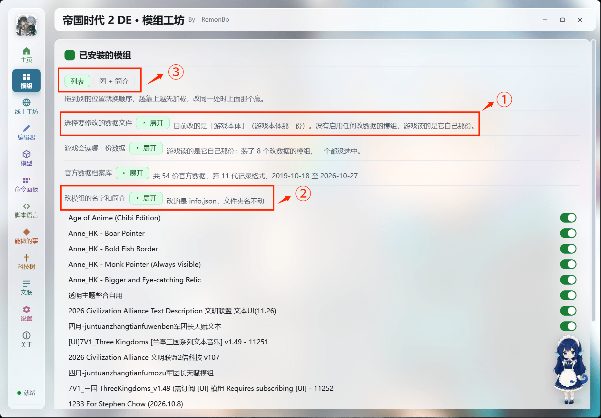

**①选择要修改的dat；**

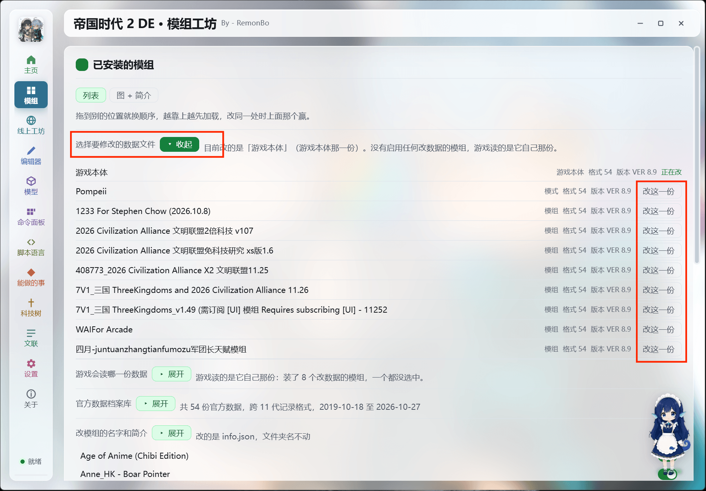

工具是自动读取local/subscribed文件夹内的dat的，所以用户请自行把内容放入这里面来，保存也是自动存入local文件夹，可另存为换名字就不会直接替换原文件夹了，建议最好单独备份一下。

②修改info简介文件；

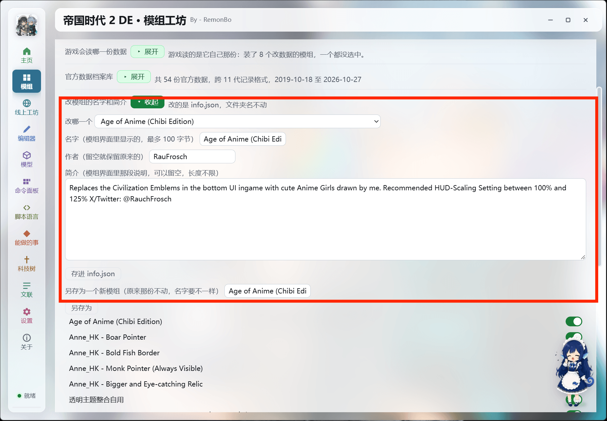

③可选择切换列表视图；**（效果如下图）**

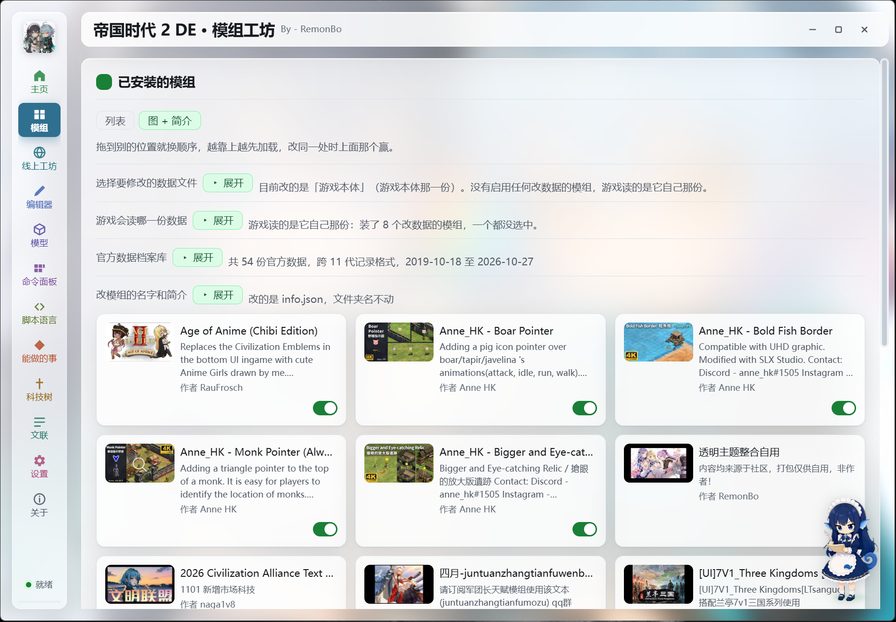

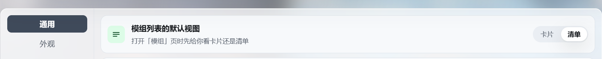

---

### 更新模组

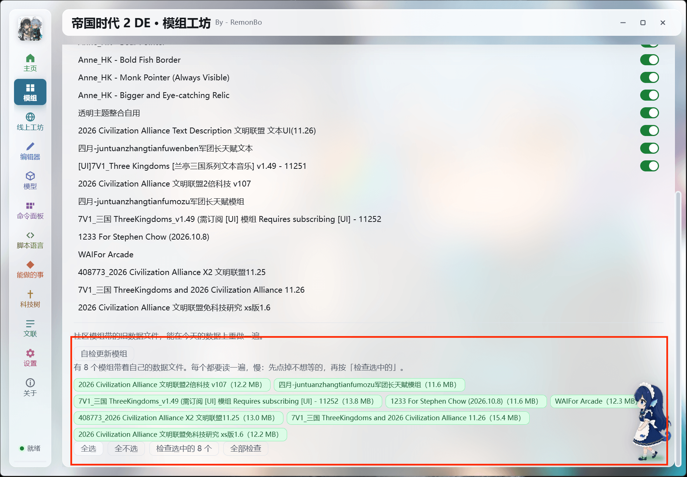

模组页往下拉，可以看到“自检更新模组”按钮，此功能自动查询本地local/subscribed文件夹内的数据模组，在选中后，点击检查，即可一键自检模组内容，后续需用户查阅后再次点击更新模组，即可将旧版本模组更新为最新官方数据。

（目前工具内整合了共 54 份官方数据，跨 11 代记录格式，2019-10-18 至 2026-10-27）——这玩意费了我好大劲！！！

（原理：通过与旧模组相同的数据进行对比，识别额外内容并迁移至新版本数据，要是旧模组在官方自己数据内容上修改的，工具是不会移植这些内容的，移植建立在官方原数据的地基上，比如旧模组改动某资源变成10倍这些，这些小改动不麻烦吧，请自行小做调整——PS：工具会自动增加5000格空白占位符以便后续整理）

---

## 三、线上创意工坊

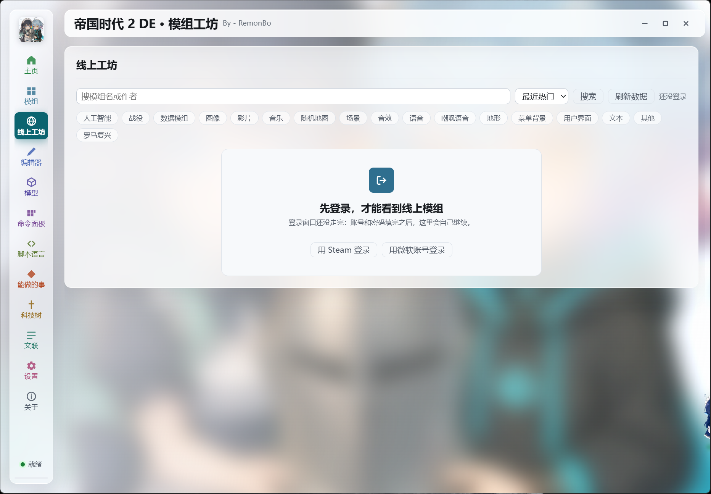

此页可提供线上创意工坊的阅览功能，因为官方的创意工坊不登陆不给看，所以需要登录账号，仅本地保存，不存cookie，每次关闭都得重新登录，以免被扣上盗号的名义。

源于：<https://www.ageofempires.com/mods/>

---

## 四、编辑器

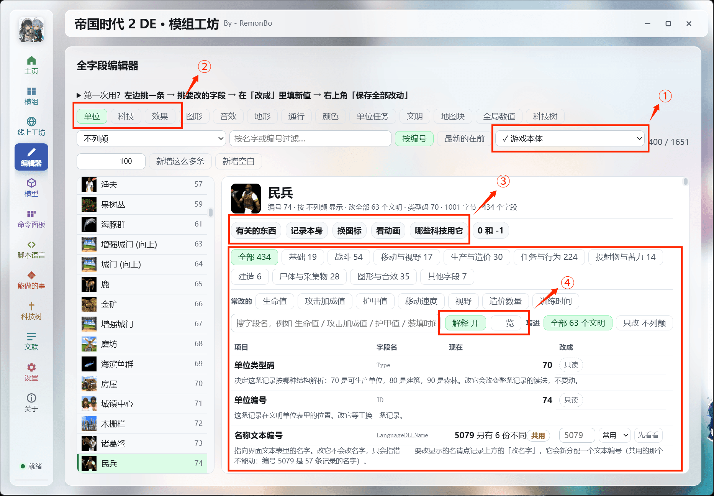

①选择要编辑的dat（如果你在模组页选了全局dat，这里也会显示的，这个可供单独修改）

②选择要编辑的页

③一些小功能（看着有个框的卡片按钮都是可以点的）

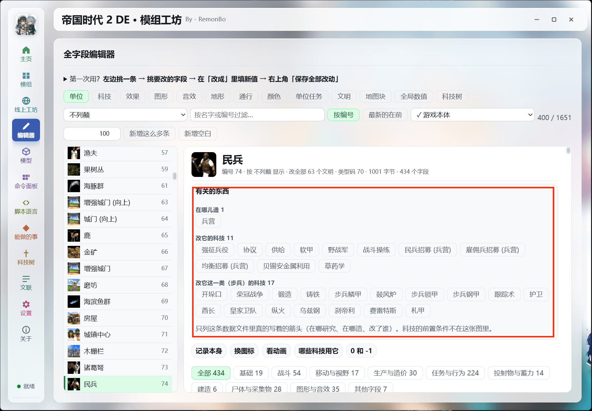

④一览功能，均可快捷跳转，如下图

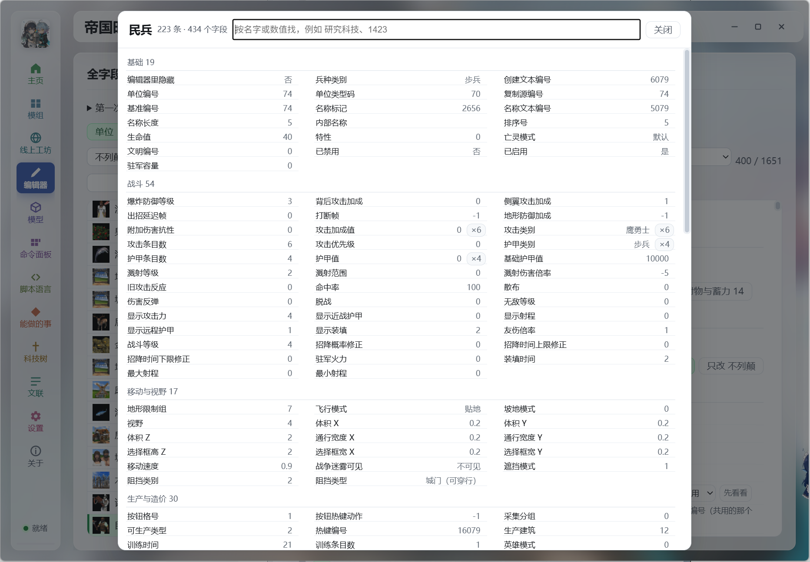

这个，你怎么用AGE3的，这你就怎么用吧，总的说数据内容的编辑全是通过修改id来用的，具体id解析找资料吧。每次改动按下图①②的顺序保存，改完按右上角「保存全部改动」或者另存为，可撤回或者直接全部重置改动。

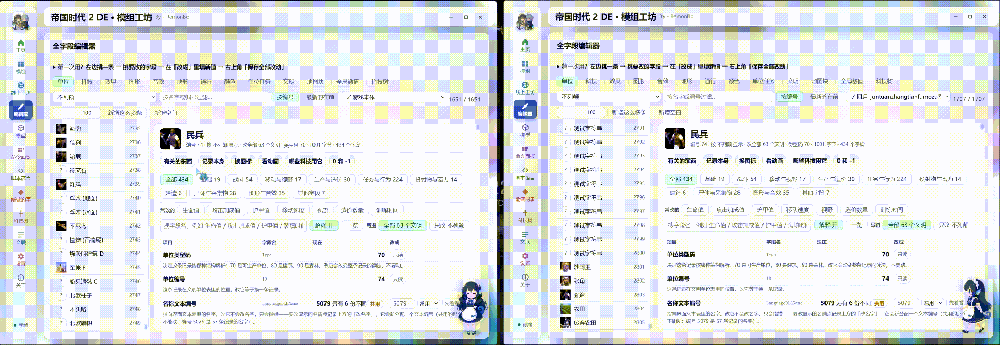

上图是一个额外的小功能，可以多开，并且在不同的dat之间进行拖拽复制粘贴，最好等加载完了再操作，不然会有延迟。

---

## 五、更换模型

更好的查看和更换单位模型

（此功能测试阶段，尚不能确保正常运作）

---

## 六、命令面板

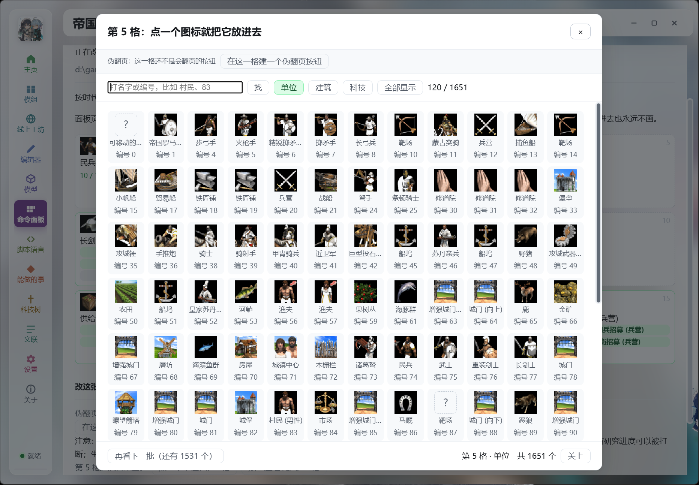

这个是模拟游戏内的左下角操作窗口的，同样是读取数据内的按钮编号等信息，可以更加直观的查看和修改，补充了个伪翻页功能，理论上可以实现无限页数。

（此功能测试阶段，尚不能确保正常运作）

---

## 七、脚本：AI 脚本和 XS 脚本

可以简单写一点脚本代码，工具能识别的情况下就能反馈代码出来，要直接转换写一整本脚本我也不确定行不行。设置页可以配置AI大模型api接口，本工具不联网！不盗号！你可以通过接入接口后，用右下角那个大肥鱼来尝试使用。

（此功能测试阶段，尚不能确保正常运作）

---

## 八、科技树

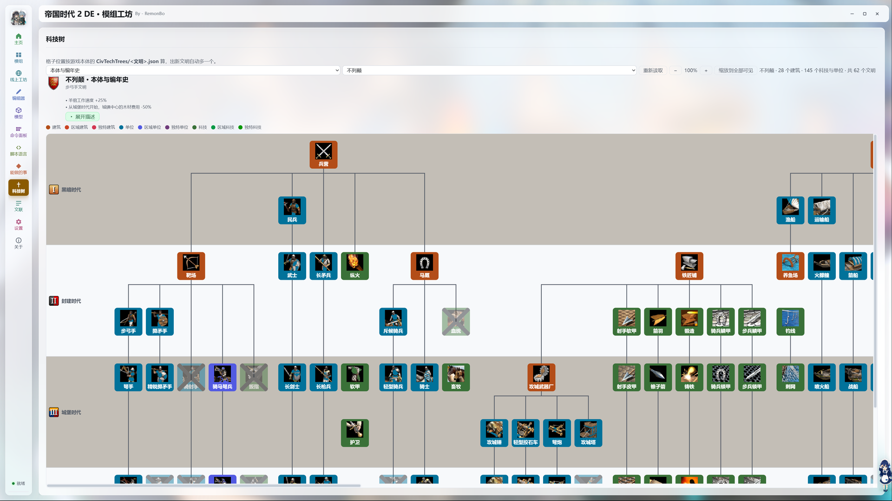

这个就不多介绍了，和游戏里一样的，方便查阅信息用，窗口可随意缩放，按ctrl+鼠标滚轮。

---

## 九、文明联盟教程和推荐解法

此面板是供文联玩家使用，外挂攻略，有各种流派推荐点法。

---

## 十、设置&关于

设置页我就不截图介绍了，自己看，多尝试

**密钥只存在本机的一个用户文件里**，不上传、不进仓库、不写进模组。

（此功能测试阶段，尚不能确保正常运作）

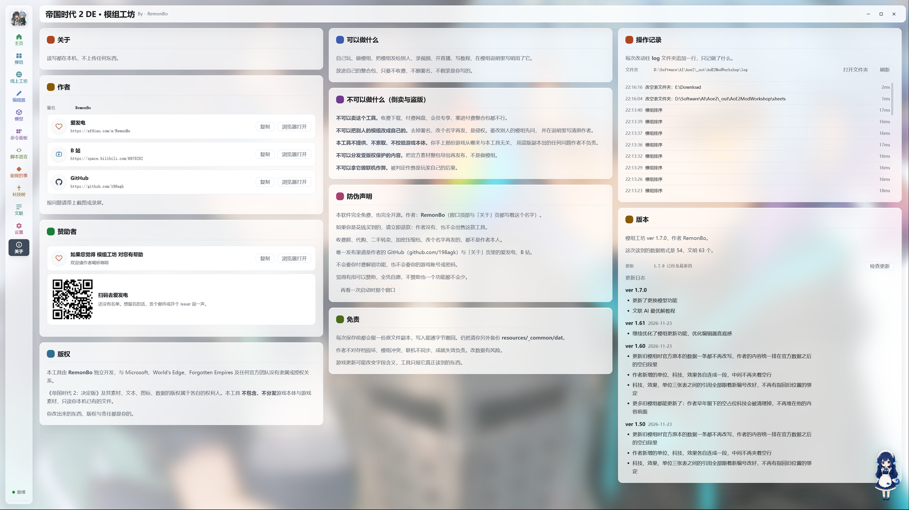

---

## 最后声明

1. 工具还在测试阶段、快速迭代
2. 有问题开 [issue](https://github.com/198agk/AoE2DEModWorkshop/issues)，或者各种联系到我的方式，带截图或录屏，说明白具体情况。
3. 软件读写都在本地，不联网，不上传。
4. 完全免费、完全开源。
5. 如果你是花钱买到的，请立即退款：作者没有、也不会出售这款工具。
6. **禁止**：任何商业用途 —— 收费下载、付费网盘、会员专享、付费整合包、收费群、代购、二手转卖、加密压缩包、企业生产使用等等。以及任何盗版修改行为和未经授权的行为。
7. 二次发布分发须在 README 与产品「关于」页写明原作者与[作者主页链接](https://github.com/198agk)
8. 游戏素材不在许可范围内：本工具不包含、不分发游戏素材。

---

## 请我喝杯咖啡

如果【AoE2DEModWorkshop】帮你省下了不少时间，不妨请开发者喝杯咖啡？

你的支持是我持续更新的最大动力！💖

爱发电：<https://afdian.com/a/RemonBo>

---

## 致谢

[genieutils](https://github.com/SiegeEngineers/genie-rs) 与社区版 Advanced Genie Editor。
