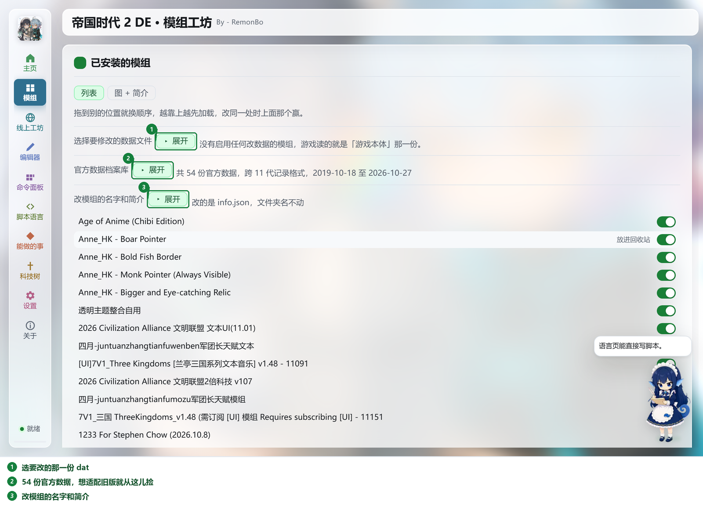
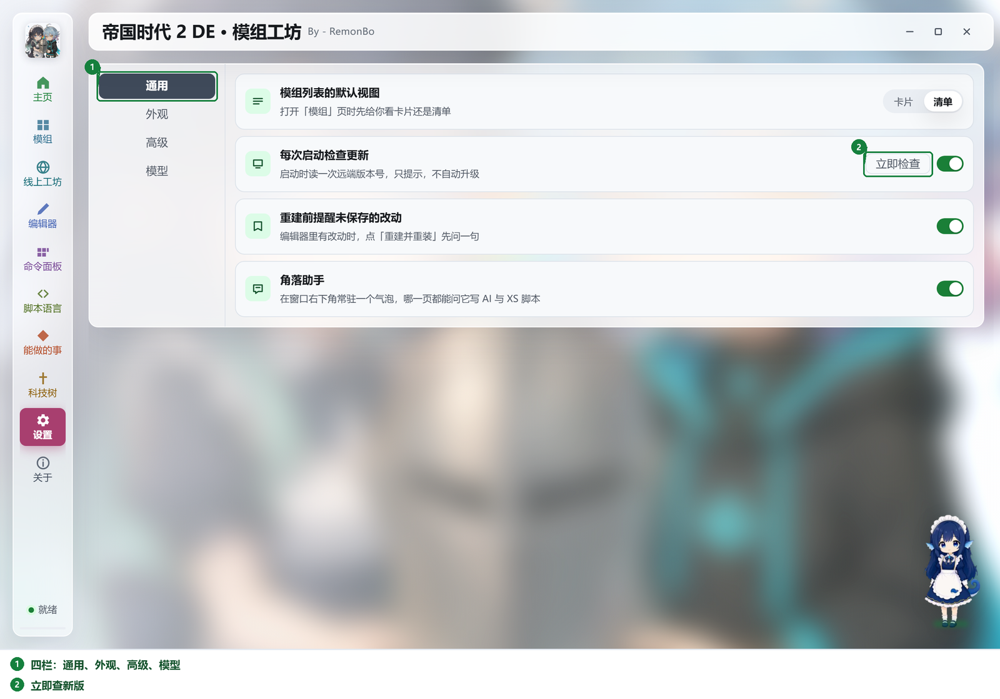

# 图文教程：挑 dat、改数值、装进游戏

打开第一件事不是改数值，是挑数据文件。

## 一、三样手选，替你省下两样



↑ 模组页。三个展开默认都收着，用哪个点哪个。

### 1. 数据文件：AGE3 那个 Browse 按钮

工具启动时自己找到游戏，自己读那一份 `empires2_x2_p1.dat`，不用你指路。要换，点第一个展开：

> 模组 → 选择要修改的数据文件 → 展开

一行一个候选，带三样东西：

- 小字：`游戏本体` / `模式` / `模组`
- 格式与版本：`格式 54`、`VER 8.9`
- 尾巴一个「改这一份」

那小字不是装饰。装过几个改数据的模组就有十几份候选，名字一水儿叫 `empires2_x2_p1.dat`，光看名字分不出谁是谁。

第二个展开是官方档案库，54 份，跨 11 代格式。要让模组也能用在旧版本上，从这儿捞一份旧的对着改。

点「改这一份」切过去，界面蒙一层，它在把那一份从头解析一遍。

### 2. 语言文件：不用指，它自己翻

AGE3 要你指 `key-value-strings-utf8.txt`，不指表格里全是裸 id。这儿省了，因为 .dat 里压根不存名字。

单位叫啥，.dat 里就一个数字，叫 `LanguageDLLName`，是个 i32。工具拿它去 `resources/<locale>/strings/key-value/` 翻表，翻 `zh`、`tw`、`en` 三份，谁在前面用谁。

所以游戏挂日语、韩语还是俄语都无所谓，界面上打出来的照样是中文名。

### 3. 新单位的名字，写在这儿

这一条最容易踩：别去动 `key-value-strings-utf8.txt`。

那是游戏本体的文件。Steam 一验完整性就还原回去，别人装了你的模组也带不走这改动。

游戏自己留了后门：每个 locale 底下躺一份 `key-value-modded-strings-utf8.txt`，605 字节的空壳，头几行用英文写着「塞进这文件里的字符串，模组开了就并进游戏自己的表」。工具往这儿写。

从 30030002 起编号，因为 30030001 往后都给官方占了。一次写 17 份，`zh` 到 `vi`，外加英文兜底。

所以新单位在游戏里叫什么，看你写模组时填的名字，跟语言文件没关系。

## 二、装：两个包，挑一个

Releases 拿最新的，两个包随便挑：

`AoE2DEModWorkshop-1.0004-setup.exe` 双击，一路下一步，装到 `%LOCALAPPDATA%\Programs\AoE2ModWorkshop`。不用管理员权限。

嫌麻烦就下 `AoE2DEModWorkshop.zip`，解压到哪都行，双击里头的 `AoE2 DE Mod Workshop.exe`。

Python 自带，环境不用你操心。

装完还有一步，卡在这儿的人最多：开游戏，单人游戏 → 创建游戏，在开局设置那个画面里找「数据模组：」，下拉框挑你刚生成的那一个。

它不在「模组」界面里。那界面翻穿了也没有，别在那儿找了。以后换模组也得回这儿重选。

## 三、第一句：村民血量改成 1000

回首页。输入框里那行灰字就是例子：

```
村民血量改成 1000
```

不会写就点「填表」，它问你改哪个单位、哪一项、改成多少，凑一句出来；或者点「看着选」，从列表里挑。

填完点「读一下」。这一步不写盘，纯试读。


↑ 一句一行写进去，点「读一下」，结果落在下面。整条链子不碰任何文件。


↑ 上面三句话，它读成三行。第二句我故意留了个读错的，等会儿说。

一条长这样：头一行是你原话，第二行是它读出来的意思 `村民 生命值 =1000`，底下几个小标签写着改的是单位还是科技、`生命值 25 → 1000`、还有范围。

范围那栏会写「Gaia、不列颠、法兰克、哥特 等 63 个」。为什么是 63？.dat 里同一个单位存 63 份，一个文明一份，就是 AGE3 表格里 `All civs` 勾不勾的那个东西。

所以你会看见 `1701 处改动（27 条记录 × 63 个文明）` 这种吓人的数。不用怕，27 个字段乘 63 份拷贝而已。

最后一行写清楚它要动哪个文件。

读错了它会当场说。上面第二句 `射手射程提高 20%` 就是：

> 「射手」不是出厂单位名，按最接近的「骑射手」读；要别的可以换一个名字

名字对不上、数值超了范围、句子看不懂，全停在这一步，不会往下写。

看着对，再往下填三个框：模组名字（游戏里显示的就是它，最多 100 字节）、作者（留空写 dsh）、简介（可以空着）。点「生成并安装」。

它把这批改动打成个模组，写进 `mods/local`，顺手在游戏的开关列表里给你点上。

一批只出一个模组。两句改到同一条数据的话，拆成两个模组会互相盖，最后只有一个算数。

然后进游戏，创建游戏 → 数据模组，选中它，开一局。村民一千血。

## 四、编辑器：一张表，620 列


一句话适合「我心里有数要什么」。想翻家底，来编辑器。

顶上十三个页签：单位、科技、效果、图形、音效、地形、通行、颜色、单位任务、文明、地图块、全局数值、科技树。AGE3 那边叫 Units、Techs、Effects、Graphics，能对上。

左边下拉按文明筛。中间那个框按名字或编号过滤，就是 AGE3 的搜索框。左边列表挑一条，右上角 `400 / 1651` 是筛出来多少、总共多少。

右边这一条的全部字段。拿民兵举例：编号 74，指到不列颠那一份，类型码 70，1001 字节，434 个字段。底下按用途分了组，战斗 54 个、移动与视野 17 个、生产与造价 30 个。

改哪儿就改「改成」那一列的数字。

两个坑，都踩过：

一个是「全部 63 个文明 / 只改 不列颠」那个开关，就是 AGE3 的 `All civs`。选「全部」写 63 份，选「只改」只写当前那份。只想让不列颠的民兵变强，记得切过去。

另一个是改完必须点右上角那个绿的「保存全部改动」。编辑器里的改动先攒在内存，窗口一关就没了。`Ctrl+Z` 撤回，「放弃」把这一轮全丢掉。

保存的时候它先给原文件留个备份（放 `log` 里），再改，改完校验，最后才写模组。校验过不了一律不写。

写着「只读」的字段点不动。别硬改，硬改整条记录的解析会错位。

## 五、命令卡：按钮挪个位置


左上先挑建筑，比如「兵营（12）」。右上选文明，默认全部。中间一行告诉你正在改哪个文件，路径给全。再往下是时代筛选，然后面板页。

游戏只画两页，第 31 格以后你写进去也永远不显示。这句提示就印在页面上。

每格有图标、名字、编号，还叠着一条小绿条，写这格到什么时代、研究了哪个科技变成什么。

拖格子换位置，点一下改训练时间或者直接拿掉，上面两个箭头翻页。改完照样得保存。

## 六、换造型：数值在 dat，样子不在

数值在 .dat 里，造型不在。单位长什么样，在 `resources/_common/drs/graphics/` 那堆 `.sld` 里。

```
把村民的样子换成步弓手
```

读一下你能看到它写的是松散 .sld，不是 .dat。装好之后村民站着就是步弓手那套动作。

用自己的图：

```
给村民换图片 我的图.png
```

路径写你本机的。它拿目标图形的帧数、尺寸、锚点挨个核一遍，哪帧对不上当场告诉你，而不是生成一个进游戏变白块的模组让你猜。

## 七、科技树拿来看，脚本拿来写


选个文明，下面一行写着这家底：多少建筑、多少科技与单位。格子位置按游戏自己的 `CivTechTrees/<文明>.json` 算，出新文明它自己就多一格。

鼠标停在格子上会点亮这条线，点一下看数值。颜色分了九类。这页是拿来看的，要改数值回编辑器。


三块：AI 脚本（.per）、XS 脚本（.xs）、整份 AI 脚本。

.per 管电脑玩家的行为，「造20个骑士」「建造兵营」，一句一条，点「写出来」变成 defrule。

.xs 能直接动运行时的数据和 goal。注意 XS 改的是运行时的值，不进 .dat，也不进模组，一局打完就没了。

写完能「校验这份脚本」。要装进游戏点「放进本地模组」。

## 八、工坊、设置、关于，三页顺一遍


不开游戏也能搜模组。得先登录，Steam 或微软账号，走游戏自己的接口。登录状态只在内存里，不写盘。

「译成中文」能把英文简介翻一遍，省得一个个猜。



四栏。常动的那几个：模组页先给卡片还是清单、启动时查不查新版、有改动时重建要不要先问你、右下角那个气泡留不留。


关于页最该看的是防伪那段。这软件免费开源，作者只有 RemonBo 一个名字。你要是花钱买的，去退款。收费群、代购、二手转卖、加密压缩包、改个名再发的，都不是作者。

免责那段也读一下。每次保存前都留了原文件副本，写入能逐字节撤回，但还是请你另外备份 `resources/_common/dat`。存档损坏、模组冲突、联机不同步、成就失效，这些作者不负责。

更新日志是从 GitHub 的发布记录里读的，每一版改了什么都能翻。检出新版会冒出「下载并装好」，按下去它自己下载二十多 MB、校验哈希、换掉旧文件、重开。只在安装版里能用，从源码目录跑的那种它会直接告诉你不行。

## 九、改了没反应？四步查下来

1. 模组页那个开关绿不绿。
2. 创建游戏 → 数据模组，选了没有。这是两码事。
3. 有没有别的模组也改了同一处、还排在它上面。上面那个赢。
4. 游戏刚更新过？去官方数据档案库看看要不要适配。

游戏打不开了，把 `resources/_common/dat` 还原成备份，或者先把模组关掉。备份在 `log` 里。

编辑器里改的东西没了，基本是没点保存就关窗口，那批改动只在内存里待着。

图标是白块，就是图形尺寸或帧数对不上。回脚本语言页用「换图片」重做，它会告诉你哪帧不对。

## 十、做不到的，先说清楚

变灰做不到。禁一项科技，按钮是直接消失，不是变灰。

新造的科技不进科技树面板，只在研究卡上待着。

渲染器改不动。能换的是磁盘上的图片和布局文件，代码里的碰不到。

同一个文件夹里 .dat 和 widgetui 只有一个生效，所以工具会拆成两个模组，两个都得勾上。

还在迭代。数值、造单位、造科技、生成模组已经实机走通了，其他在补。

## 三句能直接抄的

```
村民血量改成 1000
把不列颠村民的血量改成 1000
照织布机做一个新科技，叫铁匠学徒的手艺，研究时间 10，放在第 3 格
```

第一句所有文明一起改，第二句只改不列颠，第三句从零造一个游戏里本来没有的科技。

写错了也没关系，读一下不写盘。
