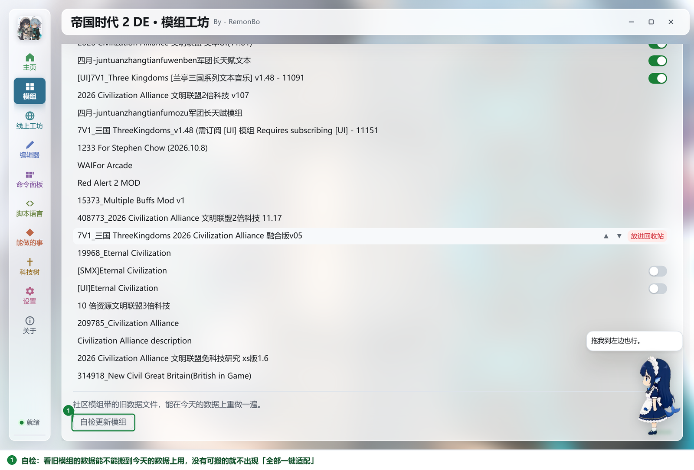
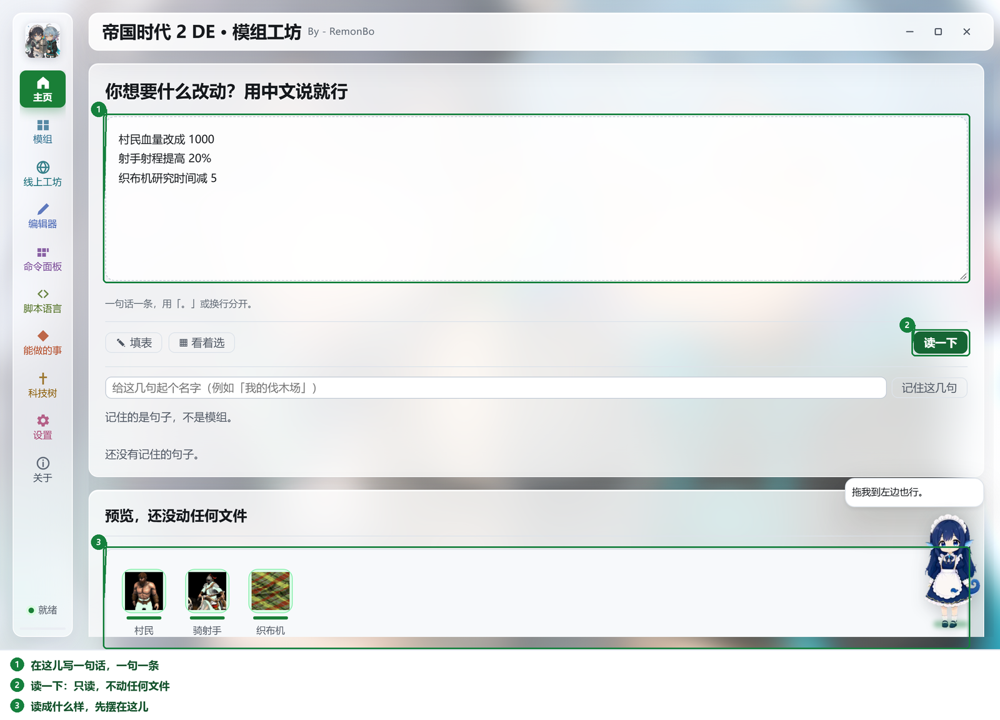

# 图文教程：挑 dat、改数值、装进游戏

## 一、挑 dat：改哪一份


三个展开默认都收着。要换数据文件，点第一个。

> 模组 → 选择要修改的数据文件 → 展开

一行一个候选，每行三样：

- 小字：`游戏本体` / `模式` / `模组`
- 格式与版本：`格式 54`、`VER 8.9`
- 尾巴一个「改这一份」

小字不是装饰。装过几个模组就有十几份候选，名字全叫 `empires2_x2_p1.dat`。

点「改这一份」切过去，界面蒙一层是它在解析那一份。

第二个展开是官方档案库，54 份，跨 11 代格式。想让模组也能用在旧版本上，从这儿捞一份旧的对着改。

编辑器顶上也有同一个下拉，两份清单是一回事。

## 二、自检更新模组：旧模组还能不能搬过来



游戏一更新，你装的改数据模组就还停在旧数据上。这颗按钮就是查这个：

1. 按「自检更新模组」。第一次它会先列出哪些模组带着自己的数据文件，点掉不想等的。
2. 按「检查选中的」。它在读每个模组的数据文件，慢，有进度条。
3. 结果一行一个模组，四种说法：能搬到今天的数据上、本来就是新版、搬不过去、有冲突。

能搬的那些，下面会冒出「全部一键适配」。按它，它按作者改过的地方重做一遍，**搬完自己校验**，校验不过不写。

自检只读不动手。适配才写盘，写之前给原文件留副本。

## 三、装：两个包，挑一个

`AoE2DEModWorkshop-1.0005-setup.exe` 双击，一路下一步。不用管理员权限，Python 自带。

嫌麻烦就下 zip，解压到哪都行，双击里头的 `AoE2 DE Mod Workshop.exe`。

装完还有一步，卡这儿的人最多：开游戏，单人游戏 → 创建游戏，在开局设置那个画面找「数据模组：」，下拉挑它。

不在「模组」界面里。翻穿了也没有。以后换模组也得回这儿。

## 四、第一句：村民血量改成 1000



一句一行写进框里，点「读一下」。这一步不写盘。

不会写就点「填表」，或者「看着选」。


一条长这样：

- 头一行：你原话
- 第二行：它读出来的意思 `村民 生命值 =1000`
- 小标签：改的是单位还是科技、`生命值 25 → 1000`、范围

范围会写「Gaia、不列颠、法兰克 等 63 个」。.dat 里同一个单位存 63 份，一个文明一份，就是 AGE3 的 `All civs`。

所以看见 `1701 处改动（27 条记录 × 63 个文明）` 别慌，27 个字段乘 63 份。

读错了当场说：「射手」不是出厂单位名，按最接近的「骑射手」读。名字对不上、数值超范围、句子看不懂，全停在这一步。

看着对，填三个框（名字、作者、简介），点「生成并安装」。写进 `mods/local`，顺手在开关列表里点上。

一批只出一个模组。两句改到同一条数据，拆成两个会互相盖。

## 五、编辑器：一张表，620 列


一句话适合「我心里有数要什么」。想翻家底来这儿。

- 顶上十三个页签：单位、科技、效果、图形、音效、地形、通行、颜色、单位任务、文明、地图块、全局数值、科技树。AGE3 那边叫 Units、Techs、Effects。
- 左上按文明筛，中间按名字或编号过滤，就是 AGE3 的搜索框。
- 右上 `400 / 1651` 是筛出多少、总共多少。

拿民兵举例：编号 74，类型码 70，1001 字节，434 个字段，按用途分组（战斗 54、移动与视野 17、生产与造价 30）。

两个坑：

- 「全部 63 个文明 / 只改不列颠」就是 AGE3 的 `All civs`。只想改一家，记得切过去。
- 改完必须点右上那个绿的「保存全部改动」。改动只在内存里，关窗口就没了。`Ctrl+Z` 撤回。

保存时先给原文件留备份（放 `log`），再改，改完校验，最后才写模组。校验不过一律不写。

写着「只读」的字段点不动，硬改会让整条记录错位。

## 六、命令卡：按钮挪个位置


- 左上挑建筑，右上选文明
- 中间一行告诉你正在改哪个文件
- 往下是时代筛选，然后面板页

游戏只画两页，第 31 格以后写了也不显示，这句就印在页面上。

每格有图标、名字、编号，还叠一条小绿条，写这格到什么时代、研究了哪个科技变成什么。

拖格子换位置，点一下改训练时间或拿掉，上面两个箭头翻页。改完照样得保存。

## 七、换造型：数值在 dat，样子不在

单位长什么样，在 `resources/_common/drs/graphics/` 那堆 `.sld` 里，不在 .dat。

```
把村民的样子换成步弓手
```

读一下能看到它写的是松散 .sld。装好之后村民站着就是步弓手那套动作。

用自己的图：

```
给村民换图片 我的图.png
```

它拿目标图形的帧数、尺寸、锚点挨个核，哪帧对不上当场说，而不是给你一个进游戏变白块的模组。

## 八、科技树拿来看，脚本拿来写


选个文明，下面一行写着这家底：多少建筑、多少科技与单位。格子位置按游戏自己的 `CivTechTrees/<文明>.json` 算。

鼠标停在格子上点亮这条线，点一下看数值。这页是拿来看的，改数值回编辑器。


- AI 脚本（.per）：「造20个骑士」一句一条，点「写出来」变成 defrule
- XS 脚本（.xs）：能动运行时数据和 goal，但不进 .dat、不进模组，一局打完就没了
- 整份 AI 脚本

写完能「校验这份脚本」。要进游戏点「放进本地模组」。

## 九、工坊、设置、关于


不开游戏也能搜模组，但要登录（Steam 或微软账号，走游戏自己的接口）。登录状态只在内存里。


四栏。常动的几个：模组页先给卡片还是清单、启动时查不查新版、有改动时重建要不要先问、右下角气泡留不留。


关于页最该看防伪那段：这软件免费开源，作者只有 RemonBo 一个名字。花钱买的去退款。

更新日志从 GitHub 的发布记录读，每一版改了什么都能翻。查出新版会冒出「下载并装好」，按下去它自己下载、校验、换掉旧文件、重开。只在安装版里能用。

## 十、没反应怎么查

1. 模组页那个开关绿不绿
2. 创建游戏 → 数据模组，选了没有（和上面是两码事）
3. 有没有别的模组也改了同一处、还排在它上面（上面那个赢）
4. 游戏刚更新过？回第二节自检一下

游戏打不开了：把 `resources/_common/dat` 还原成备份，或者先把模组关掉。备份在 `log` 里。

编辑器里的改动没了：基本是没点保存就关窗口。

图标是白块：图形尺寸或帧数不对，回第七节用「换图片」重做。

## 十一、做不到的

- 变灰做不到。禁一项科技，按钮直接消失。
- 新造的科技不进科技树面板，只在研究卡上待着。
- 渲染器改不动。能换的是磁盘上的图片和布局文件。
- 同一个文件夹里 .dat 和 widgetui 只一个生效，所以拆成两个模组，两个都要勾。

## 三句能直接抄的

```
村民血量改成 1000
把不列颠村民的血量改成 1000
照织布机做一个新科技，叫铁匠学徒的手艺，研究时间 10，放在第 3 格
```

第一句所有文明一起改，第二句只改不列颠，第三句从零造一个游戏里本来没有的科技。写错也没关系，读一下不写盘。
