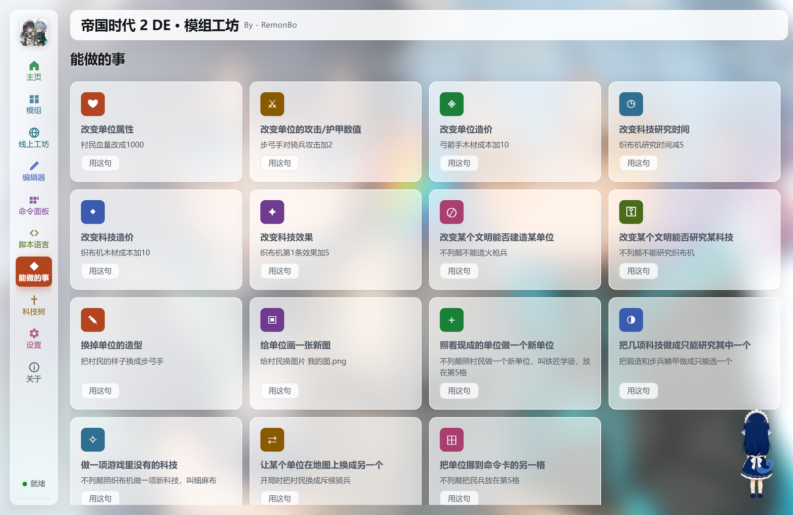
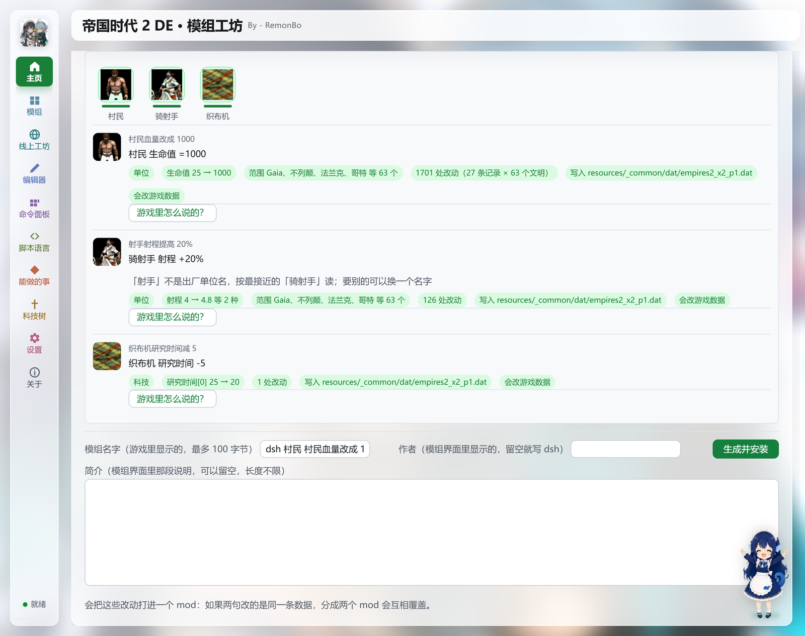
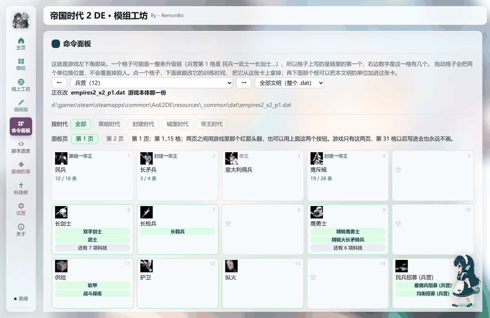
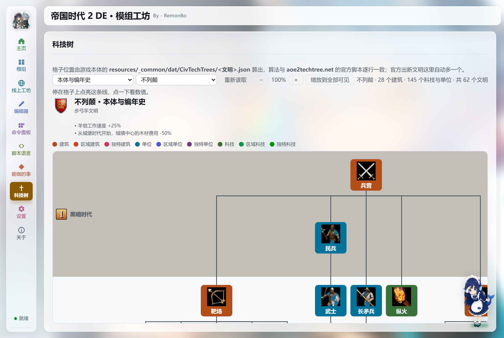
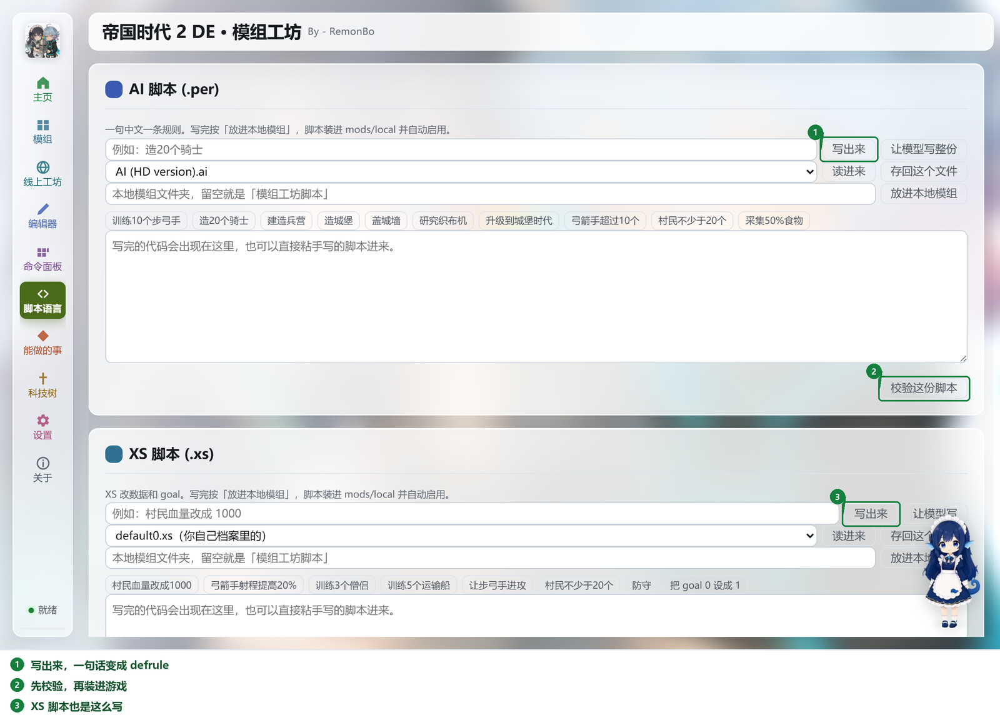
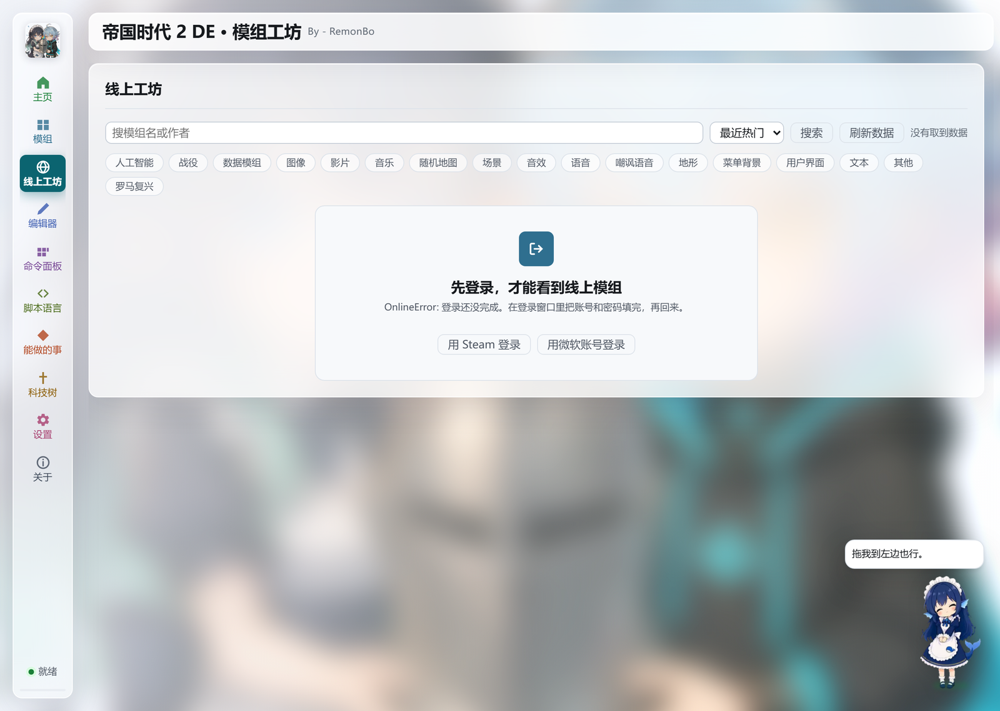

# 模组工坊 使用说明


## 这是个什么软件

《帝国时代 2 决定版》的平衡全在一个文件里：`empires2_x2_p1.dat`，放在 `resources/_common/dat/` 下。单位多少血、跑多快、一箭射多远、造一个要几块木头，都在这几万个挨着放的数字里。改错一个字节，游戏就打不开。

要动一个村民的血量，得先搞清楚它在文件里第几条、第几个字节，还有 63 个文明各存一份要不要一起改。工坊把这件事变成一句话：

> 村民血量改成 1000

然后告诉你这句话落到哪条记录的哪个字段、原来多少、改成多少、要动几个字节。你点头，它写成模组。游戏本体一个字节都不碰，所有改动都在 .dat 的一份副本上，装进游戏的 mods 目录，不想要就删文件夹。

能改的东西大概这些：

| 想做什么 | 这么说 |
| --- | --- |
| 改数值 | 村民血量改成 1000 |
| 改攻击护甲 | 步弓手对骑兵攻击加 2 |
| 改造价 | 弓箭手木材成本加 10 |
| 改科技 | 织布机研究时间减 5 |
| 造游戏里没有的东西 | 照织布机做一个新科技，叫铁匠学徒的手艺 |
| 换造型 | 把村民的样子换成步弓手 |
| 挪按钮位置 | 把民兵挪到第 5 格 |

一共十五类，一句话里可以塞好几件事，换行隔开就行。



这一页每张卡片右下角有个「用这句」，点了句子就跳到首页输入框，改两个数字就能用。不知道话该怎么说的时候，从这儿抄。

## 装

去 [Releases](https://github.com/198agk/AoE2DEModWorkshop/releases/latest) 拿最新的，两个包挑一个。

`AoE2DEModWorkshop-1.0004-setup.exe` 双击一路下一步，装到 `%LOCALAPPDATA%\Programs\AoE2ModWorkshop`，不要管理员权限。不想装就把 `AoE2DEModWorkshop.zip` 解压到哪都行，双击里面的 `AoE2 DE Mod Workshop.exe`。

自带 Python，不用配环境。卸载在「设置 → 应用」里，或者直接把文件夹删了。

装完还有一步，卡在这儿的人最多：打开游戏，单人游戏 → 创建游戏，在开局那个设置画面里找「数据模组：」，下拉框里挑你生成的那个。

它不在「模组」界面里，那边翻遍了也找不到。换一个模组要回这儿重选。

## 打开以后先看模组页


左边一竖条是导航，十个页面。先看「模组」，因为它决定你改的是哪一份数据。

上面三个「展开」：

「选择要修改的数据文件」显示当前吃哪份 .dat。一个改数据的模组都没开的时候，游戏读的是安装目录里那份原文件。你装了一个改数值的模组却没在这儿切过去，改了也白改。

「官方数据档案库」里是 54 份官方历史数据，从 2019 年 10 月发售前到 2026 年 10 月，跨 11 代格式。游戏打补丁之后，老模组记的「第几条字段」全错位，就是靠这个找回作者当初照着哪一份改的。

「改模组的名字和简介」改 `info.json`，文件夹名不动。

下面的列表是装着的模组，右边绿的是开着的。按住一条上下拖能换加载顺序，越靠上越先加载，两处改同一个数据时上面的赢。

## 第一个模组：村民的血量

回首页。输入框里的灰字就是例子，照着写：

```
村民血量改成 1000
射手射程提高 20%
织布机研究时间减 5
```

不知道怎么写就点「填表」，它问你要改哪个单位、哪一项、改成多少，拼一句出来；或者点「看着选」，从列表里挑。

然后点「读一下」。这一步一个字节都不写，只是把你的话翻成「哪张表、第几条、哪个字段、从多少到多少」，摆给你看：



每一条第一行是你的原话，第二行是它读出来的意思，`村民 生命值 =1000`。下面几个小标签写着改的是单位还是科技、`生命值 25 → 1000`、影响范围。

范围那栏是「Gaia、不列颠、法兰克、哥特 等 63 个」，因为同一个村民在文件里存了 63 份，一个文明一份。所以会出现 `1701 处改动（27 条记录 × 63 个文明）` 这种数字，就是 27 个字段乘以 63 份拷贝，不用怕。

最后一行写清楚要动哪个文件。

读错了它会说。上面第二句 `射手射程提高 20%` 就是：

> 「射手」不是出厂单位名，按最接近的「骑射手」读；要别的可以换一个名字

名字对不上、数值超范围、这句话它根本不认识，都停在这一步，磁盘上什么都不留。

看着对就往下填三个框：模组名字（游戏里显示的，最多 100 字节）、作者（留空写 dsh）、简介（可以空）。点「生成并安装」。它把这批改动打进一个模组，写进 `mods/local`，顺手在游戏的开关列表里点上。

一批只生成一个模组。两句话要是改的是同一条数据，分成两个模组会互相盖掉，只有一个生效；相关的改动一起生成就没这问题。

然后进游戏，按前面说的在「创建游戏 → 数据模组」里选中它。开一局，村民一千血。

不满意回来改数字再生成一次，想撤掉就去模组页把开关关了。

## 换造型

数值在 .dat 里，造型不在。单位长什么样在 `resources/_common/drs/graphics/` 那堆 `.sld` 里。工坊把它们拆成松散文件塞进模组，游戏优先读模组里的。

```
把村民的样子换成步弓手
```

读一下会看到它写的是松散 .sld 而不是 .dat。装好之后村民站着就是步弓手的动作。

想用自己画的：

```
给村民换图片 我的图.png
```

路径写你本机的。它会拿目标图形的帧数、尺寸、锚点核对一遍，哪一帧对不上当场说，而不是生成一个进游戏变白块的模组。

## 编辑器：一个字段一个字段地看

一句话适合「我大概知道要什么」，要翻家底用编辑器。


顶上十三个页签：单位、科技、效果、图形、音效、地形、通行、颜色、单位任务、文明、地图块、全局数值、科技树，每个对应 .dat 里一个数组。

左边下拉按文明筛，选不列颠就只看不列颠那份。中间那个框按名字或编号过滤，右边切「最新的在前」或者换数据来源。左边列表挑一条，右上角 `400 / 1651` 是筛出来多少、一共多少。

右边是这一条的全部字段。民兵的话：编号 74，指到不列颠那份，类型码 70，1001 字节，434 个字段。底下按用途分了组，战斗 54 个、移动与视野 17 个、生产与造价 30 个。要改生命值，点「常改的」里那个直接跳过去。

改法就是把「改成」那一列的数字改掉。两个地方容易出问题：

一个是同一个东西存了 63 份。右上角那个「全部 63 个文明 / 只改 不列颠」的开关，选「全部」是所有文明一起改，选「只改」只有当前筛出来的那个。只想让不列颠的民兵变强，记得切。

另一个是改完必须点右上角那个绿的「保存全部改动」。编辑器里的改动先攒在内存，关窗口就没了。`Ctrl+Z` 撤回，「放弃」丢掉这一整轮。

保存的时候它先给原文件留一份备份（在 `log` 里），再改，改完校验，再写模组。校验不过的一律不写。

写着「只读」的字段点不动。别硬改，改了整条记录会解析错位。

## 命令卡：挪按钮



这一页管游戏里那个建造、训练按钮的面板。

左上角选哪个建筑，比如「兵营（12）」。右上角选改哪个文明，默认全部。下面一行是正在改哪个文件，路径给全。再下面是时代筛选，然后是面板页：第 1 页、第 2 页。

游戏只有两页，第 31 格以后写进去也永远不画。这句提示就印在页面上。

每个格子显示图标、名字、编号，还有叠在上面的小绿条，写着这格到什么时代、研究了什么科技会变成什么。

拖动格子换位置，点一下改训练时间或者直接拿掉，上面两个箭头翻页。改完一样要点保存。

## 科技树和脚本



选文明，下面一行写这个文明的家底：多少建筑、多少科技与单位。格子位置按游戏自己的 `CivTechTrees/<文明>.json` 算，出新文明会自动多一个。

鼠标停在格子上会把这条线点亮，点一下看数值。颜色分九类：建筑、区域建筑、独特建筑、单位、区域单位、独特单位、科技、区域科技、独特科技。「缩放到全部可见」把整棵树压进一屏。

这页是看的，改数值还是回编辑器。



三块：AI 脚本（.per）、XS 脚本（.xs）、整份 AI 脚本。

.per 是电脑玩家的行为，「造20个骑士」「建造兵营」「升级到城堡时代」，一句一条，点「写出来」变成 defrule。下面那排灰标签是现成句式。

.xs 能直接改运行时的数据和 goal，「村民血量改成 1000」这种。注意 XS 改的是运行时的值，不进 .dat 也不进模组文件，一局结束就没了。

写完都能先「校验这份脚本」。要装进游戏点「放进本地模组」，它写进 `mods/local` 并自动开。

## 线上工坊、设置、关于



不用开游戏就能搜模组。输入名字或作者，右边选排序，搜，下面一排是分类。

得先登录，用 Steam 或微软账号。走的是游戏自己的接口，不经过第三方，登录状态只在内存里，不写盘也不上传。

「译成中文」会把英文模组的简介翻一遍，省得一个个猜。


设置四栏。常改的几个开关：模组页打开时先给卡片还是清单、启动时要不要查一次新版、编辑器有改动时点「重建并重装」要不要先问一句、右下角那个气泡要不要留。


关于页最该看的是防伪那段。这软件免费开源，作者只有 RemonBo 一个名字。你要是花钱买的，去退款。收费群、代购、二手转卖、加密压缩包、改个名再发的，都不是作者。

作者三个地址（爱发电、B 站、GitHub）都能一键复制或直接开浏览器。报问题带截图或录屏，说清在哪个页签点了什么。

免责那段也读一下。每次保存前都留了原文件副本、写入能逐字节撤回，但还是请你另外备份 `resources/_common/dat`。存档损坏、模组冲突、联机不同步、成就失效，作者不负责。

更新日志从 GitHub 的发布记录直接读，每一版改了什么都能翻。检出新版之后会出现「下载并装好」，按下去它自己下载二十多 MB、校验哈希、换掉旧文件、重新打开，不用你去网页下再手动覆盖。这按钮只在安装版里能用，从源码目录跑的那份会告诉你不能。

## 改了游戏里没变化，按这个顺序查

1. 模组页那个开关是不是绿的。
2. 「创建游戏 → 数据模组」里选了没有。这是两回事。
3. 有没有别的模组也改了同一处，而且排在它上面。上面的赢。
4. 游戏刚更新过？去官方数据档案库看看要不要适配。

游戏打不开了，就把 `resources/_common/dat` 还原成备份，或者关掉模组。备份在 `log` 里。

编辑器里改的东西丢了，是没点保存就关窗口了，那批改动只在内存里，找不回来。

模组装上图标是白块的，是图形尺寸或帧数对不上。回脚本语言页用「换图片」重做，它会说哪一帧不对。

## 它做不到的

变灰做不到。禁一项科技，按钮是直接消失，不是变灰。

新造的科技不进科技树那个面板，只在研究卡上。

改不动渲染器。能换的是磁盘上的图片和布局文件，代码里的东西碰不到。

同一个文件夹里 .dat 和 widgetui 只有一个生效。工具会拆成两个模组，两个都得勾上。

还在迭代。数值、造单位、造科技、生成模组已经实机走通了，其他的还在补。

## 三句现成的

```
村民血量改成 1000
把不列颠村民的血量改成 1000
照织布机做一个新科技，叫铁匠学徒的手艺，研究时间 10，放在第 3 格
```

第一句所有文明一起改，第二句只改不列颠，第三句是从零造一个游戏里没有的科技。

写错没关系，读一下不写盘。
