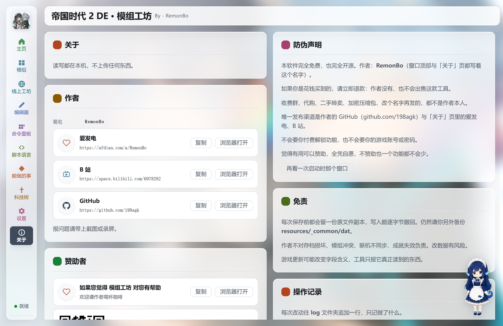

# 模组工坊 使用说明

写给用过 AGE3 的人。

AGE3 打开的时候要你自己选三样东西：Genie 版本、_dat_ 文件、语言文件。这个软件把前两样替你做了，第三样它自己有规矩。下面凡是标了「AGE3 里叫……」的地方，就是对应那一步。

## 一、开头那三样，AGE3 让你手选，这里先替你选好

### 1. 数据文件，AGE3 里是那个 Browse 按钮

`empires2_x2_p1.dat`，在 `resources/_common/dat/` 下。

工具启动时自己找游戏装在哪，自己读那一份，不用你指路。要换就是模组页第一个展开项：

> 模组 → 选择要修改的数据文件 → 展开

展开后一行一个候选：名字、名字后面一个小字写着「游戏本体」「模式」还是「模组」、`格式 54`、版本 `VER 8.9`，末尾一个「改这一份」按钮。为什么要标那个小字：装了改数据的模组之后，候选会有十几份，名字全叫 `empires2_x2_p1.dat`，光看文件名分不出谁是谁。

第二个展开是官方数据档案库，共 54 份官方数据，跨 11 代记录格式，从 2019-10-18 到 2026-10-27。想让自己的模组适配旧版本，就从这儿挑一份旧的来对着改。

点「改这一份」就换过去。切换的时候界面会蒙一层，正在把那一份整个解析一遍，等一下就回来。

### 2. 语言文件，这里没有让你选的地方

AGE3 里要你指 `key-value-strings-utf8.txt`，不然表格里全是裸 id。这里不需要，因为 .dat 里本来就不存名字。

单位叫什么，.dat 里存的是一个数字（`LanguageDLLName`，一个 i32），工具拿这个数字去 `resources/<locale>/strings/key-value/` 下面查表。它读 `zh`、`tw`、`en` 三份，按这个顺序，前面那份有就用前面的。

也就是说你游戏是日语、韩语、俄语，界面上显示的还是中文名。想改这个顺序得改源码，界面上没有开关。

（实测量过：本机 17 个 locale 各有一份，一万九千多条，最大那个编号是 30030001。这个数字后面有用。）

### 3. 那你新造的单位，名字写哪

这一条 AGE3 用户最容易踩。**不要去改 `key-value-strings-utf8.txt`。**

那是游戏本体，Steam 校验完整性一跑就还原，而且别人装你的模组也带不走这个改动。

游戏自己留了后门：每个 locale 都躺着一份 `key-value-modded-strings-utf8.txt`，605 字节的空壳，开头几行用英文写着规矩，「放进这个文件的字符串，在模组启用时会被加进游戏自己的表」。工具往这儿写。

实测：一次写 17 份，从 `zh` 到 `vi`，再加英文那份兜底，id 从 30030002 起，因为 30030001 以前都被官方占了。

所以新单位在游戏里叫什么，取决于你写模组的时候填的名字，跟语言文件没关系。


↑ 模组页。上面三个展开，第一个就是选 dat，第二个是官方档案库，第三个改名和简介。

## 二、装

Releases 拿最新的，两个包：

`AoE2DEModWorkshop-1.0004-setup.exe` 双击一路下一步，装到 `%LOCALAPPDATA%\Programs\AoE2ModWorkshop`。不要管理员权限。

或者 `AoE2DEModWorkshop.zip` 解压到哪都行，双击里的 `AoE2 DE Mod Workshop.exe`。

自带 Python，不用装环境。

装完还有一步，卡这儿的人最多：打开游戏，单人游戏 → 创建游戏，开局设置画面里找「数据模组：」，下拉框挑你生成的那个。

它不在「模组」界面里。那边翻遍了也没有，别在那儿找。换模组要回这儿重选。

## 三、第一个模组

回首页。输入框里灰字就是例子。

```
村民血量改成 1000
```

不知道怎么写，点「填表」，问你改哪个单位、哪一项、改成多少，拼一句；或者「看着选」，列表里挑。

点「读一下」。这一步不写盘。


↑ 说三句话，它读成三行结果。第二句故意留了个读错的，下面讲。

每一条长得这样：第一行原话，第二行读出来的意思 `村民 生命值 =1000`，下面小标签写改的是单位还是科技、`生命值 25 → 1000`、范围。

范围那栏写「Gaia、不列颠、法兰克、哥特 等 63 个」。为什么 63：.dat 里同一个单位存 63 份，一个文明一份，这是 AGE3 表格里 `All civs` 勾不勾的那个东西。

所以会出现 `1701 处改动（27 条记录 × 63 个文明）` 这种数字，不用怕，27 个字段乘 63 份拷贝。

最后一行写清楚要动哪个文件。

读错了它会说。上面第二句 `射手射程提高 20%` 就是：

> 「射手」不是出厂单位名，按最接近的「骑射手」读；要别的可以换一个名字

名字对不上、数值超范围、句子不认识，都停在这一步。

看着对，往下填三个框：模组名字（游戏里显示，最多 100 字节）、作者（留空写 dsh）、简介（可空）。点「生成并安装」。

它把这批改动打进一个模组，写进 `mods/local`，顺手在游戏开关列表里点上。

一批只生成一个模组。两句话改同一条数据的话，拆成两个模组会互相盖，只有一个生效。

然后进游戏，创建游戏 → 数据模组，选中它。开一局，村民一千血。

## 四、编辑器：AGE3 那张 620 列的表格


一句话适合「我知道要什么」，翻家底用编辑器。

顶上十三个页签：单位、科技、效果、图形、音效、地形、通行、颜色、单位任务、文明、地图块、全局数值、科技树。AGE3 那边叫 Units、Techs、Effects、Graphics，对应得上。

左边下拉按文明筛。中间框按名字或编号过滤（AGE3 那个搜索框）。左边列表挑一条，右上角 `400 / 1651` 是筛出来多少、一共多少。

右边这一条的全部字段。民兵：编号 74，指到不列颠那份，类型码 70，1001 字节，434 个字段。底下按用途分组，战斗 54 个、移动与视野 17 个、生产与造价 30 个。

改法是改「改成」那一列的数字。

两个坑：

一个是那个「全部 63 个文明 / 只改 不列颠」的开关，就是 AGE3 的 `All civs`。选「全部」写 63 份，选「只改」只写当前那份。只想让不列颠民兵变强，记得切。

另一个是改完必须点右上角绿的「保存全部改动」。编辑器里的改动先攒在内存，关窗口就没了。`Ctrl+Z` 撤回，「放弃」丢掉这一轮。

保存的时候先给原文件留备份（在 `log` 里），再改，改完校验，再写模组。校验不过一律不写。

写着「只读」的字段点不动。别硬改，改了整条记录会解析错位。

## 五、命令卡：挪按钮


左上选建筑，比如「兵营（12）」。右上选文明，默认全部。下面一行是正在改哪个文件，路径给全。再下面时代筛选，然后面板页：第 1 页、第 2 页。

游戏只有两页，第 31 格以后写进去也永远不画。这句提示就印在页面上。

每格显示图标、名字、编号，还有叠在上面的小绿条，写这格到什么时代、研究了什么科技变成什么。

拖格子换位置，点一下改训练时间或者直接拿掉，上面两个箭头翻页。改完一样要保存。

## 六、换造型

数值在 .dat，造型不在。单位长什么样在 `resources/_common/drs/graphics/` 那堆 `.sld` 里。

```
把村民的样子换成步弓手
```

读一下会看到它写的是松散 .sld 不是 .dat。装好之后村民站着就是步弓手的动作。

用自己画的：

```
给村民换图片 我的图.png
```

路径写你本机的。它拿目标图形的帧数、尺寸、锚点核一遍，哪帧对不上当场说，而不是生成一个进游戏变白块的模组。

## 七、科技树和脚本


选文明，下面一行写这家底：多少建筑、多少科技与单位。格子位置按游戏自己的 `CivTechTrees/<文明>.json` 算，出新文明自动多一个。

鼠标停在格子上会点亮这条线，点一下看数值。颜色分九类。这页是看的，改数值回编辑器。


三块：AI 脚本（.per）、XS 脚本（.xs）、整份 AI 脚本。

.per 是电脑玩家的行为，「造20个骑士」「建造兵营」，一句一条，点「写出来」变成 defrule。

.xs 能直接改运行时的数据和 goal。注意 XS 改的是运行时的值，不进 .dat 也不进模组，一局结束就没了。

写完能「校验这份脚本」。要装进游戏点「放进本地模组」。

## 八、线上工坊、设置、关于


不用开游戏就能搜模组。得先登录，Steam 或微软账号，走游戏自己的接口，登录状态只在内存，不写盘。

「译成中文」把英文简介翻一遍，省得一个个猜。


四栏。常改的几个：模组页先给卡片还是清单、启动时查不查新版、有改动时重建要不要先问、右下角气泡留不留。



关于页最该看防伪那段。这软件免费开源，作者只有 RemonBo 一个名字。你要是花钱买的，去退款。收费群、代购、二手转卖、加密压缩包、改个名再发的，都不是作者。

免责也读一下。每次保存前都留了原文件副本，写入能逐字节撤回，但还是请你另外备份 `resources/_common/dat`。存档损坏、模组冲突、联机不同步、成就失效，作者不负责。

更新日志从 GitHub 的发布记录读，每一版改了什么都能翻。检出新版会出现「下载并装好」，按下去它自己下载二十多 MB、校验哈希、换掉旧文件、重开。只在安装版里能用，从源码目录跑的会告诉你不能。

## 九、改了没变化，按这个顺序查

1. 模组页那个开关绿不绿。
2. 创建游戏 → 数据模组，选了没有。这是两回事。
3. 有没有别的模组改了同一处还排在它上面。上面的赢。
4. 游戏刚更新过？去官方数据档案库看要不要适配。

游戏打不开，把 `resources/_common/dat` 还原成备份，或者关掉模组。备份在 `log` 里。

编辑器里改的东西丢了，是没点保存就关窗口，那批改动只在内存。

图标是白块，是图形尺寸或帧数对不上。回脚本语言页用「换图片」重做，它会说哪帧不对。

## 十、它做不到的

变灰做不到。禁一项科技，按钮是直接消失，不是变灰。

新造的科技不进科技树面板，只在研究卡上。

改不动渲染器。能换的是磁盘上的图片和布局文件，代码里的碰不到。

同一个文件夹里 .dat 和 widgetui 只有一个生效，工具会拆成两个模组，两个都得勾。

还在迭代。数值、造单位、造科技、生成模组已经实机走通，其他在补。

## 三句现成的

```
村民血量改成 1000
把不列颠村民的血量改成 1000
照织布机做一个新科技，叫铁匠学徒的手艺，研究时间 10，放在第 3 格
```

第一句所有文明一起改，第二句只改不列颠，第三句从零造一个游戏里没有的科技。

写错没关系，读一下不写盘。